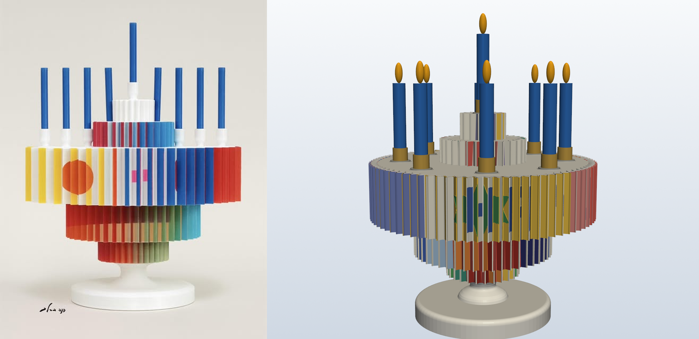

# Agam "Fire and Water" hanukkiah: 3D model

A parametric, printable hanukkiah in the style of Yaacov Agam's *Fire and Water* fountain, for a school hanukkiah
competition. The stack proportions, the goblet foot and the colour/white rhythm follow a style sketch by Dana Barlev
(`../research/user-reference-agam-menorah.png`, used as direction, not copied). The colours are the original fountain's
(`../research/fountain-colour-program.md`). Our own identity:

* **8 candles in a circle** on the main ring, in small bought metal cups (Ø 12 × 10) on stainless washers (Ø 16 × 1),
  screwed into Ø 3.4 tap holes at r 66, 11 mm visible. **The shamash** is the same holder on the white top drum,
  41 mm higher.
* **Agam's polymorph:** every pleat has a LEFT and a RIGHT face, and each face set carries its own complete picture.
  On the main ring, both face sets run the fountain's colours all the way round. The left faces carry the **Magen David
  (green)** and the **dreidel (orange)**; the right faces carry **HANUKKAH (blue)** on their white stretch. From the left
  you see the star, from the right the word, head-on the two interleave.
* **No relief on the motifs**, no outlines, no black: smooth vector edges split per face. Only the pleated sides get
  colour; every top face stays white PETG.

Built with build123d (OpenCascade) in Python. The colour program lives in `colour_program.py`.



## Parts (7 prints + the name plaque, all PETG, no supports)

| File (`out/`) | Size (mm) | Notes |
|---|---|---|
| `plinth_stem` | Ø 112 × 34.5 | Goblet foot: base disc Ø 112 × 14.5 (R2's width) with 8 ballast pockets underneath, and a concave neck 20 tall (waist Ø 22), spine socket. **Print solid (100% infill)** |
| `drum1_R1` | Ø 60 × 18 | 27 teeth |
| `drum2_R2` | Ø 112 × 31 | 50 teeth; R3 sits straight on it (no gap), keyed by the D-spine |
| `drum3_R3` | Ø 181 × 45 | main ring, 80 teeth, 8 stud holes over tooth tips, flat washer seats. **4+ perimeters, 20-30% infill** |
| `drum4_R4` | Ø 69 × 18.6 | 31 teeth; 18 tall so it rises only 7 mm above the cup rims |
| `drum5_R5_dome` | Ø 37 × 21 | white top drum with the shamash stud hole (Ø 3.4 × 8). The file keeps its old name |
| `spine` | Ø 10 × 131 | D-keyed, lying on its flat |
| `name_plaque/` | 78 × 21 × 17.8 | Name plaque: a white curved base on the foot's front (1.6 mm skin, 0.3 clearance, 3.3 above the disc, rim over its top edge) with both logo lines. `plaque_one_piece`: all in one white print to paint (letters 0.6 proud, dots 1.2). Or apart: `plaque_base` (0.4 mm sunken footprint of every piece), `letters` (31 flat pieces, the dots on their ends included: letter 1.0 thick, dot 1.6) and `dots` (the 4 loose dots, 1.6). All print without supports, the plaques upside down. `assembly.3mf` shows the pieces in place. `python plaque.py`, previews `python plaque_render.py` |

**Pleats:** a 70° V (`TOOTH_INCLUDED_ANGLE`), sharper than the fountain's ~90°. Once you stand more than 35° to one side,
the other face set turns away, which is what lets each picture show alone. The tooth tips (the silhouette) are
unchanged; only the valleys are deeper (5 mm). Pitch 7 mm at the tips on every ring.

**Buy first, then measure and set in `config.py`:** 9 closed-bottom menorah cups (OD ≤ 13, ~10 tall) with an M4 stud.
The ring cups take a stud 8-10 long; **the shamash needs one ≤ 8**. Also 9 stainless washers Ø 16 × 1 and 4 M10 washers
for ballast: **32 M10 washers, required** (see Stability).

## Print settings

PETG, 235-245 °C nozzle and 75-85 °C bed, textured PEI or glue stick, 0.2 mm layers, 3 perimeters (4 on R3, R4 and R5),
15% gyroid (30% on the foot for weight), no supports or brim, 0.4 nozzle. Stud holes are plain Ø 3.4 for an M4 stud to
self-tap; if a test stud is too tight, set `STUD_HOLE_D` to 3.5-3.6. Joints have 0.40 clearance for two coats of paint.

## Assembly

Paint each part first, sides only. Spine into the foot, then R1, R2, R3, R4, R5 (the D-key lines them up; HANUKKAH and
cup 1 face the front). Washer on each seat, screw a cup through it finger-tight. Do the test burn first (concept §3).

## Stability (run on every build, with 9 lit candles)

```
[FAIL] tips at 33 deg without ballast (>= 35): mass ~834 g, centre of mass 87 mm up, foot r 56.0
[ok] tips at 37 deg with ballast (8 pockets x 4 M10 washers) (>= 35): mass ~970 g, centre of mass 75 mm up, foot r 56.0
```

**The ballast is required:** 32 M10 washers (DIN 125, Ø 20 × 2), 4 stacked in each of the 8 pockets under the foot (glue
them in). The sketch's foot (Ø 103) would tip at about 31° even with ballast, so the disc is R2's width, Ø 112. Masses
are estimates: 1.4 mm shells plus 15% infill, the foot printed solid, and brass cups, washers and new candles. Concept §3
rates 21° too wobbly, 31° marginal and 46° fine; ASTM F2601 tests at 10°. If the test print feels light, add washers or
steel shot.

## Safety and halacha checks (run on every build)

```
[ok] 8 cup rims at one height, 45 deg apart: Z 138.4 mm on r 66.0
[ok] holders visible <= 11 above R3: 11.0 mm (washer 1.0 + cup 10.0)
[ok] R4 rises <= 7 above the rims: 7.0 mm
[ok] axis to R4 tooth tips >= 25: 31.8 mm (check in the test burn)
[ok] axis to other plastic above the rims (R5) >= 40: 48.0 mm
[ok] flame spacing >= 40: 50.5 mm between neighbours
[ok] shamash >= 20 above the ring: +38.0 mm (rim Z 176.4)
[ok] stud hole wall to R3's pleated outline >= 3: 17.53 mm (cups over tooth tips, turned +2.25 deg)
[ok] washers inside R3's tooth tips: washer edge r 74.0 (tips r 90.0)
[ok] shamash stud hole clear of the spine: 8.0 mm of PETG between them (hole 8.0, spine 4.0 into R5)
```

**Cups moved in to r 66** (from 81), per the viewer feedback. To keep that safe under concept §5, R4 is now 18 tall (sketch
~21), so it rises exactly 7 mm above the rims. Its teeth may then come as close as 25 mm (they are 31.8 mm away); R5,
higher, keeps 48 mm (rule 40). Chord between cups 50.5 mm (rule 40). The concept still says r 81 / R4 0.62 and needs
updating (CANDLE_RING_R 66, R4 0.38 × 18 mm).

The 70° pleats deepen R3's valleys. So R3's tooth count is rounded to 80 (a multiple of 8) and the cups turn 2.25° to
sit over tooth tips; at a valley the stud-hole wall would be only 2.3 mm.

**White printed candle collars (as in the sketch): not added.** Concept §5 rules 5-6 say no plastic may touch a cup, and
no collars or bosses. A collar round a Ø 12 cup would put PETG 2-4 mm from the hot cup wall, at the height where the
flame burns in the last minutes. The washers and cups stay metal.

## Colour program (`colour_program.py`)

The real fountain's program, `../research/fountain-colour-program.md` (default variant). Its data is copied into
`fountain_colours.py`: the 1986 palette (15 colours; the darkest is navy, a clear blue, not black) and, per ring and face
set, sectors in fountain angles. The research turns them by +207° to place the fountain's own disc; the disc is gone, so
`colour_program.py` turns them by **+245°** (`ROTATION`). That puts the white stretch of R3's right faces at model +20°,
where HANUKKAH goes, and yellow on R3's left faces under the star and dreidel. The foot is all white, the tops
white.

**Three motifs and a sufganiyah on R3**, each large, painted on one face set only, with no outline (fine guide relief only):

| Motif | Face set (seen from) | Where | On |
|---|---|---|---|
| **HANUKKAH**, blue, one line of face-column letters (`column_letters.py`: each column is one whole tooth face, blue full height or in bands whose edges run straight across the whole face, never breaking inside it; only N's diagonal and K's arms slope, each over two faces, K's arms parting exactly on a ridge; no notches or curves), cap height 31 mm (70% of R3), 32 faces = 144° wide | right faces (from the right) | starts at -9° (a tooth edge) and runs right (`WORD_START_DEG`) | a white band from -28.5° to 154.5° (covers the three blue fountain faces after the word) |
| **Magen David**, green, solid, 37 mm | left faces (from the left) | front, 0° | yellow |
| **Dreidel**, orange silhouette, no letter, 37 mm | left faces (from the left) | back, 182.25° (the middle of a face, so its handle is one whole face) | yellow |
| **Sufganiyah**: orange ellipse 57 x 26 mm with a brick-red jam dot (was the fountain's disc) | right faces (from the right) | back, 212° | white |

**Exact edges, no pixels.** Each motif is a vector shape (font outline or geometry, 240 points per curve), unrolled onto
its face set. Each face carries one tooth's slice of the picture. On every face the motif crosses, the face is split along
the exact outline (shapely), so a face can be part letter and part background with a smooth boundary. The renders, maps
and GLB all use these exact pieces; only the pleats slice the curves.

**Why the word starts at -8° (now -9°, the nearest tooth edge)** (measured; `previews/test_two_pictures_R3_000{_at30,,_at50}.png`): a viewer 40° to the
left of the front sees no right faces at all from about -10° onward (with 70° pleats; 60° or 50° pleats gain only 5-10°,
so the pleats stay at 70°). So the word starts there and is hidden from 30-50° left, where only the Magen David shows.
From 40° right of the front, "HANU" reads, and the whole word reads as you walk round to the right
(`test_two_pictures_R3_060.png`). A picture that reads in full from 40° right and is hidden from 40° left of the same spot
can be at most ~30° wide on this ring: the Magen David and the dreidel are, an 8-letter word cannot be.

**Lower drums R1 and R2** use the research's "sketch" variant: the fountain's colours as continuous gradients on both face
sets (no white sectors), so they read as rich colour; white shows only as the ridge separators. **The foot is all white.**

**How the pictures read** (`previews/test_two_pictures_R3_{000,180}.png`, 40° left / head-on / 40° right): from any
viewpoint, the half of a ring to your left shows its right faces and the half to your right shows its left faces.
- **At the front:** from 40° right, HANUKKAH reads in one line on white; from 40° left, the green Magen David reads on
  yellow, with no trace of the word; head-on the two interleave.
- **At the back:** the dreidel reads from the left, the sufganiyah from the right.

To change colours: edit `fountain_colours.py` (sectors, or `VARIANT = "sketch"` for gradient lower drums and a white
top drum), `ROTATION` or the motifs in `colour_program.py`, then run the build.

**Map angles are checked on every build:** each motif's centre in the maps (the vector shapes they draw) is compared
with where its paint lands on the model mesh (renders, GLB); a mismatch over 3° prints MOTIF ANGLES DO NOT MATCH.
Every motif is faceted (`facets.py`): rebuilt on the tooth grid so each piece crosses its face from ridge to ridge with straight edges; tips end in a point on a ridge, wide ends stop on a ridge.

Current: Magen David 0° (left faces), HANUKKAH 63° (right faces, spans -9° to 135°), dreidel 173.25° (left faces, ends at 180°), sufganiyah 211.5° (right faces, 8 faces, 193.5° to 229.5°, so three faces apart). The star and sufganiyah are sized to the tooth grid (`grid_stretch`): every Magen David corner sits on a ridge, the sufganiyah closes to a point on a ridge at each side, and its two-face jam dot has its corners on ridges.

## Start arrows (engraved)

Every ring has a small arrow (5 × 2.4 mm) sunk 0.4 mm into its flat top face and its flat bottom face, just inside the
pleat roots (`start_marks.py`, `START_ARROW_*`). Its tail sits on `SEAM_DEG` (157.5°, between two candles), where every
painting map starts, and it points the way the maps run (counter-clockwise seen from above: left to right as you face
the ring). Sunk, not raised, so it never shows from the side. `START_ARROWS_ENABLED = False` removes them.

## Guide relief (very subtle)

A raised line, 0.3 mm high × 0.6 mm wide (`GUIDE_LINE_*`), along each motif outline: the HANUKKAH letters, the Magen
David, the dreidel and the disc. It sits only on the face set that carries the motif, so it cannot show the motif from
the other side. It is mapped onto each face exactly like the paint, and stops 1.2 mm short of the crest and valley ridges
and of the top and bottom edges. A 0.3 × 0.6 locating ring round every cup seat (0.3 mm clear of the washer) centres
the washers, the shamash's too. Under paint the lines all but vanish; they are for taping and for a steady brush.
Close-up: `previews/closeup_guide_relief.png` (relief in red). `GUIDES_ENABLED = False` removes it.

## Scaled full test rings of R3 (print one before the real R3)

`out/test_ring_R3_50.stl`, `out/test_ring_R3_60.stl` and `out/test_ring_R3_70.stl` (+ 3MF), made by `test_ring.py`
(scales in `TEST_RING_SCALES`). Each is **R3 rebuilt at that size, not a scaled mesh**: diameter, height, pitch, cup
circle and washer marks shrink. The things that must still print and paint at a 0.4 nozzle keep their real size: paint
ridges 0.8 × 0.6 mm, guide relief 0.3 × 0.6 mm. All three motifs are on it, at their places, so both pictures can be
judged from 40° left (Magen David) and 40° right (HANUKKAH). Flat closed bottom (no spine hole), seat rings as marks only
(no stud holes).

| Ring | Size (mm) | Teeth | Pitch | Narrowest paint zone | Material (solid) | Est. print (0.28 mm, 2 walls, 10% gyroid) |
|---|---|---|---|---|---|---|
| `test_ring_R3_50` | Ø 90 × 22 | 80 | 3.5 | 2.25 mm | 135 cm³ | ~3 h |
| `test_ring_R3_60` | Ø 108 × 26.4 | 80 | 4.2 | 2.86 mm | 232 cm³ | ~4.5 h |
| `test_ring_R3_70` | Ø 126 × 30.8 | 80 | 4.9 | 3.47 mm | 367 cm³ | ~6 h |

The tooth count does not have to drop at any of these scales: the pitch would only be clamped (and the tooth count
reduced, rounded to a multiple of 8) if a pleat face fell below `TEST_RING_MIN_ZONE` (2 mm), which happens below
about 46%. The print times are estimates from shell area plus infill, not sliced here; check your slicer.

* **Print:** PETG, 0.28 mm layers (0.2 for crisper guide lines), 2 walls, 10% gyroid, no supports, no brim, flat side
  down. 0.4 nozzle.
* **Paint:** `out/maps/map_test_ring_R3_60_A_left.png` and `map_test_ring_R3_60_B_right.png` (1:1 at 60%): picture A
  on the left faces, picture B on the right faces. For the 50% / 70% rings, set `TEST_RING_RENDER_SCALE` and run
  `python test_ring.py` to get their maps.
* Renders: `previews/test_ring_R3_60_from_left.png`, `..._from_front.png`, `..._from_right.png`.

## Test coupon (print this first)

`out/test_coupon_R3.stl` (+ 3MF) is R3 from -20° to +30° (`COUPON_*`), cut from the real part. It has the same pleats,
the guide relief and cup 1's seat (stud hole, locating ring). Painted, it shows the first part of the Magen David (left
faces) and the letters around "NUK" (right faces). It is 75 × 43 × 45 mm and stands on R3's flat bottom. It is hollowed
from below (2.4 mm walls, 1.6 mm top skin) with a solid boss round the stud hole: 37 cm³ of plastic.

* **Print:** PETG, 0.28 mm draft layers, 2 walls, 10% gyroid infill, no supports, no brim. The hollow's ceiling bridges
  about 25 mm; turn on "detect bridging". Estimated 1-1.5 h (not sliced here: check your slicer's estimate).
* **Then:** test the M4 stud and washer fit, scuff, prime and paint it with `out/maps/map_test_coupon_R3.png` (picture A on
  the left faces, picture B on the right faces), and look from 40° left and 40° right before painting R3.
* Renders: `previews/coupon_painted_from_left.png`, `previews/coupon_painted_from_right.png`.

## Magen David test cut

`out/test_star_R3.stl` (+ 3MF) is R3 from -19° to +17° (`STAR_COUPON_*`), cut the same way as the coupon above, at full
size. It holds the whole Magen David (its green runs -13° to +11°) on the left faces, "HA" on the right faces and cup 1's
seat. 54 × 38 × 45 mm, 30 cm³, same print settings as the coupon. Paint it with `out/maps/map_test_star_R3.png`.
Renders: `previews/test_star_R3_painted_from_left.png`, `..._from_right.png`.

## Outputs

* **Maps** (`out/maps/`, A4, 1:1, SVG + PNG): for each ring `map_Rn_A_left` and `map_Rn_B_right`. Each face set is drawn
  unrolled as its own picture, each tooth's face the full tooth wide, so the kids paint picture A on all left faces, then
  picture B on the right faces. Each map has paint numbers, a degree scale, tooth numbers, a FRONT marker and overlap marks.
  `map_tops_stem` marks the white tops and the washer seats.
* **GLB** (`out/hanukkiah_painted.glb` 0.9 MB, `out/hanukkiah_white.glb` 0.6 MB, `out/GLB.md`): Y-up, metres, one
  material per paint, a node per part, `metal`, `candles` and `flame_*` anchors. No normals are stored, so viewers shade
  flat.
* **Previews:** `painted_*`, `white_*`, `reference_bare_*`, `test_two_pictures_*`, `compare_style_sketch.png`, and
  close-ups of the cup seat, the shamash seat and the ridges.

## Changing parameters

Edit `config.py` (geometry) or `colour_program.py` (colours), then run:

```bash
cd agam-hanukkiah/model && .venv/Scripts/python build.py
```

About 1 minute. `python maps.py` and `python glb_export.py` redo just those, after a build. Setup:

```bash
cd agam-hanukkiah/model && python -m venv .venv && .venv/Scripts/python -m pip install -r requirements.txt
```

Files: `config.py`, `colour_program.py` + `colour_types.py`, `fountain.py` (foot, rings, spine), `hanukkiah.py` (R3,
cups, checks), `emblems.py` (motif shapes), `relief.py` (Magen David), `profiles.py` (pleats, stud hole), `parts.py`,
`paint_program.py` (picture → paint per cell), `paint_mesh.py` (paint per triangle; R3's sides rebuilt as a cell grid),
`render.py`, `maps.py`, `glb_export.py`, `build.py`.

## Not done / limits

* Not test-printed or test-burned.
* The real fountain's top-view photo (`research/user-reference-top.png`) was superseded by the style sketch as the
  master reference, so no top-photo comparison was made.
* With white tops and gradients, the lower drums don't use the A/B split strongly. Only R3 carries full pictures.
