# מדריך צביעה: חנוכיית "אש ומים" בהשראת אגם

מדריך להורה. השלבים המסומנים 👧 מתאימים לבנות; השלבים המסומנים 🧑 הם להורה בלבד.

> **מקור הצבעים: `agam-hanukkiah/model/colour_program.py`** (והטבלה של המזרקה ב־`model/fountain_colours.py`). ממנו נוצרים ההדמיות, קובץ ה־GLB וגם **מפות הצביעה** ב־`model/out/maps/`. המדריך הזה מסביר **איך** צובעים, והמפות אומרות **מה** צובעים בכל פאה. **אם יש סתירה, המפה קובעת.**
>
> **מקור החלקים:** `model/README.md`. 7 הדפסות PETG: **רגל** (דיסקית Ø112 עם צוואר, כולה לבנה), **R1** (27 שיניים), **R2** (50, R3 יושבת ישר עליה), **R3** הטבעת הרחבה (Ø181, 80 שיניים, 8 הנרות), **R4** (31), **R5** תוף עליון לבן עם השמש (16), ו**ציר**. 8 הנרות עומדים ב**גביעי מתכת קטנים** (Ø12) על **דסקיות נירוסטה** (Ø16), מוברגים לחורים במדרגה של R3 ברדיוס 66 מ"מ. השמש באותו גביע, על R5.
>
> **הצבעים הם של המזרקה המקורית (1986): 15 גוונים.** אין שחור (הכי כהה: נייבי), ו**כל המשטחים העליונים נשארים לבנים**. רק הצדדים המשוננים נצבעים. **שלושה סמלים, כולם על R3:** HANUKKAH בכחול (באותיות של פאות שלמות: כל פאה כחולה כולה או בפסים אופקיים), מגן דוד בירוק, וסביבון בכתום (צללית, בלי אות). ומאחור: **סופגנייה** כתומה עם נקודת ריבה אדומה (5 לבנה).
>
> **לפני הכול: טבעת ניסיון** (`model/out/test_ring_R3_60.stl`): R3 שלמה ב־60%, עם שלושת הסמלים, שעליה מנסים כל שלב. החלופה: קופון, פרוסה של R3 בגודל אמיתי. סעיף 4.

---

## 0. בקצרה

1. 🧑 **מדפיסים קודם את טבעת הניסיון (60%)** ועוברים עליה את כל הדרך: פריימר, סלוטייפ, שתי התמונות, לכה. בדיקת חום עם גביע: על הקופון או בבדיקת השריפה (סעיף 4). רק אחר כך את החלקים האמיתיים.
2. 🧑 **הכנה ל־PETG:** שיוף עדין, ניגוב בכוהל איזופרופילי, **פריימר לפלסטיק** ואז פריימר לבן בספריי (בחוץ), ובדיקת סלוטייפ. לפני ההתזה ממסכים את 9 מושבי הדסקיות ואת החיבורים.
3. 🧑 **מדפיסים את המפות** (`model/out/maps/`) בגודל אמיתי, 100%, ומסמנים "חזית" על כל טבעת (סעיף 5).
4. 👧 **כל טבעת לבד, צד אחד בכל פעם:** בכל שן יש **פאה שמאלית ופאה ימנית**. על הפאות השמאליות צובעים **תמונה A**, ועל הימניות **תמונה B**. לכל אחת מפה משלה. משמאל רואים את A, מימין את B, ומלפנים את שתיהן מעורבבות. זה הטריק של אגם (סעיף 3).
5. 👧 **הסמלים על R3** בסוף כל צד: קודם הרקע הבהיר, ואז הסמל, עד **הקו הבולט הדק** שמסמן את קצה הסמל (סעיף 7).
6. **הרגל כולה לבנה**, וגם **כל המשטחים העליונים**: לא צובעים.
7. 🧑 לכה על בסיס מים. **בלי לכה על מושבי הדסקיות ובחיבורים.** ייבוש 48 שעות לפני הדלקה ראשונה.

---

## 1. הכנת ההדפסה (🧑 הורה בלבד)

> **למה PETG דורש יותר הכנה מ־PLA:** המשטח של PETG חלק, מעט שמנוני ו"לא אוהב" צבע. צבע אקרילי או Posca ישירות עליו נראה טוב יום אחד, ואז מתקלף בציפורן או נשרט בקצוות השיניים. שלושה דברים פותרים את זה, ואף אחד מהם לא אופציונלי: **שיוף עדין, ניקוי באלכוהול, ופריימר שמיועד לפלסטיק.** מה שכן טוב ב־PETG: הוא לא נמס ממדללים של ספריי, אז פריימר וספריי רגילים בטוחים עליו.
>
> **כל מה שכאן עושים קודם על טבעת הניסיון** (סעיף 4). אם משהו לא עובד עליו, משנים לפני החלקים האמיתיים.

### 1.1 ניקוי ראשון
- מסירים "שערות" (stringing) ופצעונים עם סכין יפנית חדה או סכין מודלים. ב־PETG יש הרבה "שערות" דקות; אפשר גם להעביר מעליהן מהר מאוד אקדח אוויר חם (מייבש שיער לא מספיק), בזהירות כדי לא לעוות. **כלים חדים וחום רק להורה.**
- את הקצוות החדים של השיניים מעגלים מעט בנייר שיוף, כדי שהצבע לא יתקלף שם ושהבנות לא יישרטו.

### 1.2 שיוף עדין של הצדדים המשוננים
- **נייר שיוף 320 עד 400 (רטוב־יבש), או ספוג שיוף עדין** (Scotch-Brite אפור, או ספוג שיוף "fine"/"superfine"). עוברים על **כל הצדדים שייצבעו** עד שהברק נעלם והמשטח מט אחיד. זה "עוגן" לפריימר. לא צריך להעלים קווי שכבה. את המשטחים העליונים מספיק לשייף מעט, כי הם מקבלים רק פריימר ולכה.
- **בשיניים:** ספוג השיוף נכנס לחריצים טוב יותר מנייר. מעבירים לאורך השיניים, מלמטה למעלה.
- **לא לוחצים חזק ולא משייפים בכלי חשמלי:** PETG רך ונמרח בחום החיכוך, ונוצרים "שערות" לבנות. אם זה קורה, מורידים אותן בסכין.
- **⚠️ הקווים הבולטים הדקים:** על R3, לאורך קצוות שלושת הסמלים, יש **קו בולט עדין מאוד** (0.3 מ"מ גובה, 0.6 מ"מ רוחב), ועל כל מושב דסקית **טבעת מיקום** באותו גובה. הם עוזרים להדביק נייר מיסוך ולעצור את הטוש. **באזור הסמלים לא משייפים בכלל, רק ספוג עדין במגע קל**, אחרת הקווים נעלמים.

### 1.3 ניקוי באלכוהול
- שוטפים את אבק השיוף במים עם מעט סבון כלים ומברשת שיניים ישנה לחריצים, ומייבשים היטב (שעה לפחות, גם בתוך השיניים).
- **מנגבים בכוהל איזופרופילי (IPA, 70% עד 99%)** על מטלית נקייה שלא משאירה סיבים. זה מסיר שמנוניות ושומן אצבעות, שהם הסיבה העיקרית לקילוף ב־PETG. נמכר בבתי מרקחת ובחנויות אלקטרוניקה, כ־20 עד 30 ₪ לליטר.
- **מכאן נוגעים רק עם כפפות** (ניטריל), או מחזיקים מבפנים, בחור המרכזי.

### 1.4 פריימר לפלסטיק
**ההמלצה: שתי פחיות מאותה סדרה: "פריימר לפלסטיק" (מקדם הדבקה) ואחריו פריימר לבן.**
1. **מקדם הדבקה לפלסטיק** (Plastic Primer / Adhesion Promoter): שכבה דקה אחת, כמעט שקופה. למשל **Motip Plastic Primer** (שקוף) או **Rust-Oleum Plastic Primer**, בחנויות חלקי רכב וצבע לרכב, ACE והום סנטר. כ־40 עד 60 ₪. זה השלב שהכי חשוב ב־PETG.
2. **פריימר לבן** (רצוי "פריימר מילוי" לבן מאותו יצרן) מעליו, תוך הזמן שכתוב על הפחית של מקדם ההדבקה (בדרך כלל 10 עד 30 דקות). **פריימר לבן אחד שכתוב עליו במפורש "לפלסטיק" (Plastic) מחליף את שני השלבים.** פריימר רגיל לעץ או לקיר לא מתאים.
- **למה לבן:** הפריימר הוא **צבע 1 לבן** של המזרקה. **כ־90 פאות מסומנות 1 במפות** (כחמישית מכל הפאות, כולן על R3, R4 ו־R5), והן פשוט נשארות מהפריימר. גם כל המשטחים העליונים והרקע של HANUKKAH והסופגנייה. צבעים בהירים (צהוב, מנטה, תכלת) יוצאים נקיים רק על לבן.
- **איך:**
  - בחוץ או במרפסת פתוחה, בלי רוח, בטמפרטורה מעל 15°C. מסכה (FFP2 לפחות) וכפפות. **הבנות לא נמצאות בסביבה בזמן ההתזה.**
  - מנערים דקה. מרחק 25 עד 30 ס"מ, בתנועות רציפות שמתחילות ונגמרות מחוץ לחלק.
  - **שכבות דקות**: מקדם הדבקה שכבה אחת; פריימר לבן שתיים. שכבה עבה נוזלת וממלאת את הקווים הבולטים הדקים. מסובבים את החלק כדי להגיע לשתי הפאות של כל שן.
  - **ייבוש לילה לפחות** לפני צביעה. על PETG פריימר מתקשה לאט יותר מאשר על PLA; צביעה מוקדמת מדי מורידה אותו יחד עם הצבע.
- **בדיקת הדבקה (5 דקות, חובה):** על **טבעת הניסיון** (סעיף 4.2), אחרי ייבוש לילה: חורצים בסכין רשת קטנה (# של 4 × 4 משבצות, 2 מ"מ), מדביקים עליה סלוטייפ חזק, ותולשים בבת אחת. **אם משבצות ירדו, ההכנה לא מספיקה:** משייפים, מנקים ב־IPA ומוסיפים מקדם הדבקה. אם הכול נשאר, אפשר לצבוע.
- **לפני ההתזה, ממסכים את מה שנשאר PETG נקי.** המיסוך נשאר עד אחרי הלכה:
  - **9 מושבי הדסקיות** (8 על המדרגה של R3, אחד על R5): פלסטלינה בחור הבורג, ומעליו **עיגול נייר מיסוך Ø16 שנכנס בדיוק בתוך טבעת המיקום**. הכי קל: מניחים את דסקית הנירוסטה עצמה על נייר מיסוך, חותכים סביבה, ומדביקים בתוך הטבעת.
  - **החור המרכזי** של כל טבעת (צורת D, הציר עובר בו), והמשטחים שבהם החלקים יושבים זה על זה (התחתית של כל טבעת, והמשטח שעליו היא נחה). החיבורים מתוכננים עם מרווח שמספיק לשתי שכבות בלבד.
  - **8 הכיסים מתחת לרגל** (שם מדביקים את משקולות הדסקיות M10): פס נייר מיסוך על כל כיס. דבק נתפס טוב יותר ב־PETG נקי.
  - **למה המושבים:** מתכת על PETG נקי יושבת שטוח ויציב, וצבע מתחת לדסקית חמה היה מתרכך ונדבק.

**חלופה בלי ספריי (פחות מומלצת ב־PETG):** אחרי שיוף ו־IPA, ג'סו אקרילי לבן (Amsterdam או Royal, כ־30 ₪ ל־250 מ"ל) במכחול רך, שתי שכבות דקות, ייבוש 24 שעות, ובדיקת ההדבקה. על PETG ג'סו נתפס חלש יותר מפריימר לפלסטיק, ובמכחול הוא גם ממלא את הקווים הדקים. כאן הקופון חשוב במיוחד.

### 1.5 מה **לא** לתת לבנות לעשות
- סכינים, שיוף במכונה, ספריי מכל סוג (פריימר, לכה), דבקים חזקים, וכל עבודה עם הברגים, הדסקיות, הגביעים והמשקולות.
- לא צובעים לפני שהפריימר יבש, ולא צובעים חלקים מורכבים.

---

## 2. איזה צבע לקנות

### 2.1 השוואה

| | צבעי אקריליק (בקבוק/שפופרת) + מכחול | טושים אקריליים (Posca PC-5M / PC-3M) |
|---|---|---|
| הדבקות על PETG מעל פריימר לפלסטיק | מצוינת | מצוינת |
| על PETG בלי פריימר | **חלשה**, מתקלף בציפורן | **חלשה** |
| קלות לילדות | דורש שליטה במכחול ובכמות | **קל מאוד**, כמו טוש |
| פאה של שן (כ־3.5 מ"מ רוחב) | בינוני (מכחול 2) | **מצוין**, ראש של 1.8 עד 2.5 מ"מ |
| קצוות של סמלים | בינוני (מכחול 0) | **טוב** (PC-3M, PC-1MR) |
| **גוונים מעורבבים** (לבנה, פריווינקל) | **אפשר לערבב בדיוק** | רק אם יש גוון מוכן קרוב |
| מחיר לגוון | נמוך | גבוה יותר |

**ההמלצה: Posca לכל השיניים, אקריליק לשני גוונים שאין בטוש.**
- **Posca PC-5M** לכל הפאות. כאן יש **408 פאות, מהן כ־320 בצבע** (השאר לבנות מהפריימר). כל אחת פס צר, בדיוק לזה טוש נוח.
- **Posca PC-3M** לקצוות הסמלים, ו־**PC-1MR** לפרוסות הכי צרות ולתיקונים ב־ג.
- **אקריליק** לשני הגוונים של המזרקה שאין להם טוש קרוב: **5 לבנה** (אדום־חום) ו־**8 פריווינקל** (כחול־סגלגל). מערבבים פעם אחת בצנצנת קטנה עם מכסה, מספיק לשתי שכבות ולתיקונים (סעיף 3.3).

### 2.2 מה **לא** לקנות
- צבעי גואש/טמפרה "רחיצים" לילדים: לא נדבקים לפלסטיק, נסדקים, מתקלפים ונמסים בלחות.
- צבעי שמן, אנמל, או צבע רכב בספריי לבנות: ממסים ואדים.
- טושים פרמננטיים על בסיס אלכוהול (טושי סימון): דוהים ונמרחים מתחת ללכה.
- פריימר או לכה לעץ/לקיר: לא נתפסים ב־PETG. רק מוצרים שכתוב עליהם "פלסטיק" (Plastic) לפריימר.

### 2.3 בטיחות וכביסה
- מחפשים על האריזה את התו **AP** (ACMI, "Approved Product") או EN71-3. Posca ורוב הגוונים הבסיסיים של Amsterdam ו־Royal מסומנים כך.
- אקריליק ו־Posca הם על בסיס מים: יורדים מהעור ומהמכחולים במים וסבון **כל עוד הם רטובים**. **אחרי ייבוש הם קבועים על בגדים**, אז לובשים סינר או חולצה ישנה ופורסים מפה (ניילון או שקית זבל פתוחה).
- לא מכניסים מכחולים לפה. שוטפים ידיים בסוף.

### 2.4 איפה קונים בישראל (מחירים משוערים, נכון לסוף 2026)
- **אופיס דיפו, קרביץ, גלי:** סטים של Posca, צבעי אקריליק בסיסיים, מכחולים ונייר דבק. מבחר הגוונים הבודדים מצומצם, אז כדאי לבדוק מלאי באתר לפני שיוצאים.
- **חנויות אמנות ויצירה** (ארט דיפו, דרור ליצירה, פיקאסו ארט, האטלייה ועוד): מבחר מלא של Posca בודדים ושל Amsterdam בכל הגוונים. **כאן קונים: 15 הגוונים של המזרקה לא נמצאים בשום סט.**
- **חנויות תחביב ומודלים:** נייר מיסוך Tamiya (גם הגמיש, לקווים מעוגלים) ומכחולים עדינים.
- **חלקי רכב / ACE / הום סנטר:** פריימר ולכה בספריי.

| פריט | מחיר משוער |
|---|---|
| Posca PC-5M בודד | 16.50 עד 22 ₪ |
| Posca PC-3M / PC-1MR בודד | כ־17 עד 20 ₪ |
| אקריליק Amsterdam 120 מ"ל | כ־20 ₪ |
| אקריליק Royal / Artmate 120 מ"ל | 12 עד 18 ₪ |
| פריימר בספריי 400 מ"ל | 35 עד 60 ₪ |
| לכה אקרילית על בסיס מים | 25 עד 45 ₪ |
| נייר מיסוך Tamiya 6 או 10 מ"מ | 15 עד 25 ₪ |
| נייר מיסוך Tamiya גמיש לקימורים (2 או 3 מ"מ) | 20 עד 30 ₪ |

---

## 3. הצבעים של אגם: תמונה A, תמונה B

### 3.1 הטריק
כל טבעת בנויה מעשרות **שיניים משוננות אנכיות**, בזווית חדה. לכל שן **שתי פאות**: **שמאלית** (פונה שמאלה כשעומדים מול הטבעת) ו**ימנית**.

**כל צד נושא תמונה שלמה משלו:**
- **תמונה A** על **כל הפאות השמאליות**. רואים אותה כשעומדים **משמאל** (בערך 40° הצידה).
- **תמונה B** על **כל הפאות הימניות**. רואים אותה כשעומדים **מימין**.
- ממש מלפנים רואים את שתיהן, פס אחרי פס, מעורבבות.

בחזית של R3 זה הכי בולט: **מימין קוראים HANUKKAH** בכחול על לבן; **משמאל רואים מגן דוד** ירוק על צהוב, בלי זכר למילה. מאחור, משמאל, **סביבון** כתום, ומאחור מימין **סופגנייה** כתומה עם ריבה. כשהולכים סביב החנוכייה, כל הטבעות מחליפות צבע: זה האגמוגרף של אגם, בפסל.

**הצבעים הם "המסע" של המזרקה:** בכל טבעת ובכל צד, רצפים של כמה פאות באותו צבע (2 עד 5 שיניים ב־R1 וב־R2, ועד 20 ב־R3), ואחריהם צבע אחר או רצף לבן. זה לא קשת שחוזרת פאה אחרי פאה: **רוב הזמן צובעים כמה פאות רצופות באותו טוש**, וזה הרבה יותר קל.

### 3.2 התוכנית לכל חלק (במפות: פאה אחרי פאה)

המסע מתחיל ב**חזית** (0°: נר 1, אמצע מגן הדוד, ו־8° אחרי תחילת HANUKKAH) והולך משמאל לימין, כמו במפה. המספרים: צבעים מהטבלה בסעיף 3.3.

| חלק | שיניים | תמונה A, פאות שמאליות (רואים משמאל) | תמונה B, פאות ימניות (רואים מימין) |
|---|---|---|---|
| R1 (תחתונה) | 27 | **מעבר צבעים** בלי לבן, פעמיים מסביב: **4 אלמוג**, **3 כתום**, **2 צהוב**, **14 ירוק**, **13 טורקיז**, **5 לבנה** | אותו מעבר, **צעד אחד לפני** A: **5 לבנה**, **4 אלמוג**, **3 כתום**, **2 צהוב**, **14 ירוק**, **13 טורקיז** |
| R2 | 50 | **מעבר צבעים** בלי לבן, פעמיים מסביב: **4 אלמוג**, **5 לבנה**, **11 נייבי**, **10 כחול**, **9 תכלת**, **3 כתום** | אותו מעבר, **צעד אחד לפני** A: **3 כתום**, **4 אלמוג**, **5 לבנה**, **11 נייבי**, **10 כחול**, **9 תכלת** |
| **R3** (הרחבה) | 80 | **2 צהוב** (רוב הטבעת), **6 ורוד**, **4 אלמוג**, **3 כתום**, **7 לילך**. **מגן דוד 14 ירוק** בחזית, **סביבון 3 כתום** (צללית בלבד) מאחור (173°) | **רצועה לבנה** מ־28°− עד 154°+ ועליה **HANUKKAH ב־10 כחול** (מ־9°− עד 135°+); אחריה לבן ועליו **סופגנייה 3 כתום עם ריבה 5 לבנה** (194° עד 230°), **7 לילך**, **8 פריווינקל**, לבן |
| R4 | 31 | לבן, **13 טורקיז**, **12 מנטה** | **4 אלמוג**, **7 לילך**, **6 ורוד**, לבן |
| R5 (תוף עליון) | 16 | **7 לילך**, **2 צהוב**, **3 כתום**, פעמיים מסביב | **9 תכלת** ולבן |
| רגל | | **כולה לבנה: לא צובעים** | |
| **כל המשטחים העליונים** | | **לא צובעים** (לבן מהפריימר): המדרגות של R2, R3, R4 ו־R5 והרגל | |
| ציר, דסקיות, גביעים, משקולות | | **לא צובעים** | |

**לא סופרים: עוקבים אחרי המפה.** הטבלה רק כדי לדעת אילו טושים צריך לכל טבעת.

### 3.3 הפלטה: 15 הצבעים של המזרקה

| # | צבע | Hex | Posca (גוון קרוב, לבדוק מול הדף) | אקריליק Amsterdam (קרוב) | כמה פאות (כ"פאות R3") |
|---|---|---|---|---|---|
| 1 | **לבן** | `#F4F1E4` | White (לתיקונים) | Titanium White 105 | כ־90 (**הפריימר**) + הרקע של HANUKKAH והסופגנייה, הרגל, כל המשטחים העליונים |
| 2 | צהוב | `#F2C94C` | Sunshine Yellow | Azo Yellow Medium 269 | **53 (44)** + הרקע של מגן דוד והסביבון. **הכי הרבה** |
| 3 | כתום | `#E8893F` | Light Orange | Azo Orange 276 + לבן | 47 (33) + **הסביבון** |
| 4 | אלמוג | `#E8655C` | Coral Pink | Pyrrole Red 315 + לבן | 42 (26) |
| 5 | **לבנה** | `#A8322A` | אין טוש מדויק: **אקריליק** | **Naphthol Red Deep 399** | 27 (16) |
| 6 | ורוד־סלמון | `#DC8A86` | Salmon Pink | Persian Rose 330 + לבן | 18 (15) |
| 7 | לילך | `#9A8CC0` | Lavender | Perm. Blue Violet 568 + לבן | 16 (10) |
| 8 | **פריווינקל** | `#7484C4` | אין טוש מדויק: **אקריליק** | **Ultramarine 504 + Blue Violet 568 + לבן** | 19 (19), כולן על R3 |
| 9 | תכלת | `#A3C1E0` | Light Blue | Sky Blue Light 551 | 20 (13) |
| 10 | **כחול** | `#3E5FB0` | Blue | Ultramarine 504 | 24 (19) + **HANUKKAH** |
| 11 | נייבי | `#2B2F6B` | Navy Blue | Ultramarine 504 + Prussian Blue 566 | 18 (12) |
| 12 | מנטה | `#A8DDB5` | Mint | Turquoise Green Light 660 + לבן | 6 (2) |
| 13 | טורקיז | `#3E8F7C` | Emerald Green | Turquoise Green 661 | 18 (8) |
| 14 | ירוק | `#4E9E5E` | Green | Perm. Green Light 618 | 9 (4) + **מגן דוד** |
| 15 | אפור | `#A9B3B6` | | | **לא בשימוש כרגע** (הרגל לבנה) |
| 0 | לא צובעים | | | | מושבי הדסקיות, החיבורים, הכיסים |

הערות:
- **"כ"פאות R3"** = כמה צבע הולך באמת. פאה של R3 גבוהה 44 מ"מ, ושל R1 או R4 רק 18. לכן צהוב (רובו על R3) נגמר ראשון, ומנטה בקושי נוגעים בו.
- **המספרים זהים במפות, ב־`colour-chart.html` וב־`colour_program.py`.** המפות כתובות באנגלית; הדף הצבעוני מתרגם.
- **הגוונים של המזרקה רכים ומעט "מאובקים"**, לא צבעי טוש בוהקים. **שמות הגוונים של Posca משתנים בין סדרות וחנויות:** בחנות מצמידים את הדף המודפס לטוש ובוחרים בעין, ואם אין קרוב מספיק, לוקחים אקריליק ומערבבים עם מעט לבן. הצבע על הפקק כהה מהצבע היבש.
- **לבנה ופריווינקל באקריליק:** 🧑 מערבבים פעם אחת כמות לכל העבודה (כחצי כוס קטנה), משווים לדף על טבעת הניסיון, וסוגרים היטב. ערבוב שני כמעט אף פעם לא יוצא אותו גוון. צובעים במכחול עגול 2.
- **צהוב, כתום, ורוד ומנטה** מכסים חלש. מתכננים 2 עד 3 שכבות.
- **נייבי וכחול** מכסים חזק, אבל הם הכי קשים לתיקון. לכן הם נצבעים **אחרונים** בכל צד (סעיף 6.4).

---

## 4. ניסיון קודם: טבעת ניסיון של R3 (🧑 עם 👧 בצביעה)

**למה:** כל טעות שעושים על הניסיון היא טעות שלא עושים על R3, וכמה שעות של הדפסה זה הרבה פחות מהדפסה של R3 מחדש. יש שתי אפשרויות:

| | **טבעת ניסיון 60% (מומלץ)** | קופון (חלופה) |
|---|---|---|
| קובץ | `model/out/test_ring_R3_60.stl` (או `.3mf`) | `model/out/test_coupon_R3.stl` |
| מה זה | **R3 שלמה, בנויה מחדש ב־60%**: Ø108 × 26.4 מ"מ, אותן 80 שיניים | פרוסה של R3 בגודל אמיתי, מ־20°− עד 30°+ (75 × 43 × 45 מ"מ) |
| מה רואים עליה | **כל הסמלים, כל אחד במקומו**: מגן דוד, **HANUKKAH כולה**, סביבון, והסופגנייה. אפשר ללכת סביבה ולבדוק את שתי התמונות מכל צד | חצי מגן דוד (A), ו־"HAN" (B) |
| קווים דקים | בגודל אמיתי (0.3 מ"מ), כמו על R3 | בגודל אמיתי |
| מושב לגביע | **רק סימון** של טבעות המיקום, **בלי חור לבורג** | **מושב אמיתי של נר 1**: חור לבורג וטבעת מיקום |
| מפות | `map_test_ring_R3_60_A_left.png`, `map_test_ring_R3_60_B_right.png` (1:1 בגודל 60%) | `map_test_coupon_R3.png` (A ו־B בדף אחד) |
| הדפסה | כ־4.5 שעות (0.28, 2 קירות, 10% מילוי) | שעה עד שעה וחצי |

**ההמלצה: טבעת 60%.** רק עליה רואים אם HANUKKAH נקראת מימין ומגן הדוד משמאל, וזה העיקר. אם רוצים גם את **בדיקת החום עם גביע אמיתי** (שורה 7 למטה), מדפיסים בנוסף את הקופון, או עושים את הבדיקה הזאת בבדיקת השריפה המלאה. יש גם טבעות **50%** (Ø90, כ־3 שעות, צפופה יותר לצביעה) ו־**70%** (Ø126, כ־6 שעות); למפות שלהן צריך להריץ את `python test_ring.py` עם `TEST_RING_RENDER_SCALE` אחר (`model/README.md`).

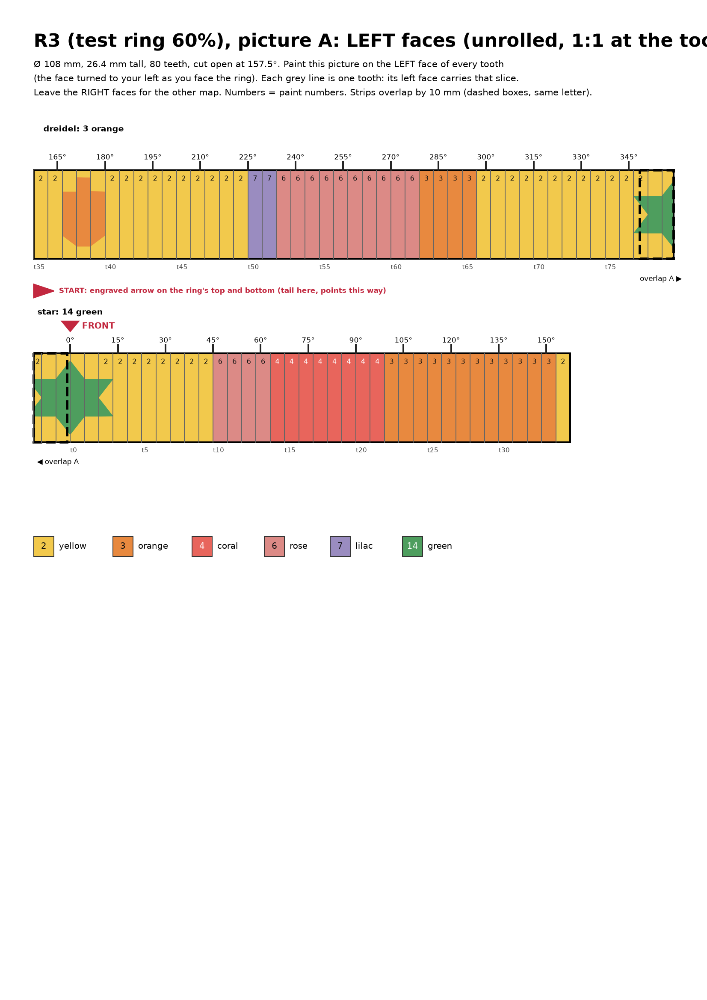
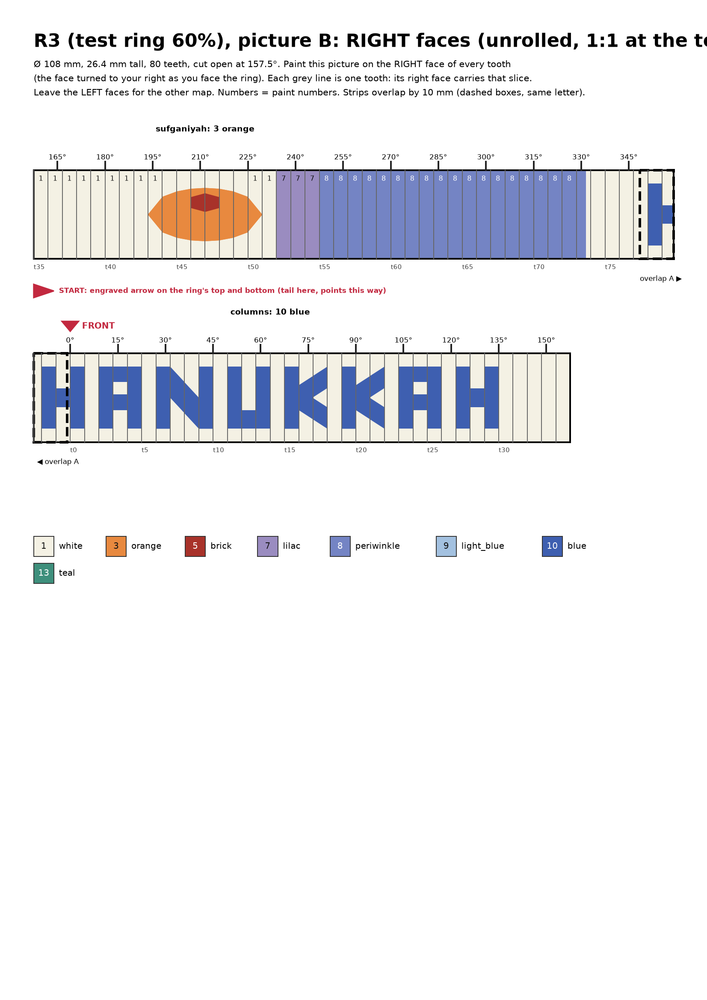

### 4.1 הדפסה ובדיקות לפני צבע
- **הדפסה:** PETG, שכבות 0.28 (או 0.2 לקווים דקים חדים יותר), 2 קירות, 10% gyroid, בלי תמיכות ובלי ברים, הצד השטוח למטה. הקופון חלול מלמטה עם גשר של כ־25 מ"מ: מפעילים בסלייסר "זיהוי גשרים".
- **בודקים שהקווים הדקים תואמים למפה:** מדפיסים את המפה ב־100%, מצמידים ומשווים. על טבעת 60%, **10 שיניים במפה = 42 מ"מ** (לא 70: היא קטנה יותר). על הפאות השמאליות הקווים עוברים לאורך מגן הדוד בחזית והסביבון מאחור; על הימניות לאורך HANUKKAH, שמתחילה **9° משמאל לחזית** ונמשכת ימינה עד **135°**; והסופגנייה מאחור, בין 194° ל־230°. **אם הקווים מראים משהו אחר או במקום אחר, עוצרים** ומבררים עם בונה המודל לפני שמדפיסים את R3.
- **על טבעת 60% הפאות צרות יותר** (הצרה ביותר 2.86 מ"מ, לעומת כ־3.5 ב־R3). צובעים אותה ב־**PC-3M**, לא PC-5M. אם זה מצליח שם, על R3 יהיה קל יותר.
- **על הקופון, החומרה:** מניחים דסקית נירוסטה בתוך טבעת המיקום (צריכה להיכנס בלי כוח, ולשבת במרכז), ומבריגים גביע. אם הבורג קשה מדי, מעדכנים את קוטר החור לפני שמדפיסים את R3.

### 4.2 מה מנסים, ומה מחפשים

| # | בודקים | איך | מה צריך לראות | אם לא |
|---|---|---|---|---|
| 1 | **הדבקת פריימר** | הכנה מלאה כמו בסעיף 1 (שיוף, IPA, מקדם הדבקה, פריימר לבן, לילה). רשת 4 × 4 בסכין **על התחתית השטוחה**, סלוטייפ, תלישה | אף משבצת לא יורדת. הקווים הבולטים עדיין מורגשים בציפורן | משבצות יורדות: שיוף חזק יותר ו־IPA. הקווים נעלמו: פחות פריימר, שכבות דקות יותר |
| 2 | **נייר מיסוך לאורך הקו הדק** | על **פאה אחת** של מגן הדוד: מדביקים Tamiya (גמיש, 2 עד 3 מ"מ) כך שהקצה **נשען על הקו הבולט מבחוץ**, לוחצים בציפורן, צובעים צהוב, ומסירים כשהצבע כמעט יבש, בזווית נמוכה | קו חד, בלי זליגה מתחת לנייר, והפריימר לא עולה עם הנייר | זליגה: לוחצים יותר, או מוותרים על המיסוך ועובדים "עד הקו" (סעיף 7.3). פריימר עולה: ייבוש ארוך יותר לפני מיסוך, או נייר פחות דביק |
| 3 | **"עד הקו" בלי מיסוך** | על פאה שכנה: הטוש נעצר בקו הבולט, בלי נייר | הילדה מצליחה להשאיר את הקו כגבול. אם זה עובד, **אין צורך במיסוך בכלל** | עובדים עם מיסוך על הסמלים, ובלי מיסוך בשאר |
| 4 | **שתי התמונות** | **תמונה A** על כל הפאות השמאליות (כל המסע, מגן הדוד והסביבון). ייבוש שעה. **תמונה B** על הימניות (המסע ו־HANUKKAH) | מ־40° שמאלה מהחזית: מגן הדוד על צהוב, בלי שום כחול. מ־40° ימינה: "HANU" נקראת, והמילה כולה כשהולכים ימינה סביב הטבעת. מאחור, משמאל: הסביבון. מלפנים: מעורבב, וזה בסדר | צבע עבר את קודקוד השן: הילדה מטה את הטבעת יותר (סעיף 6.3), או טוש עם ראש דק יותר |
| 5 | **כיסוי וגוונים** | 2 ו־3 שכבות של צהוב; ירוק וכתום מעל צהוב; כחול על לבן. **לבנה ופריווינקל מהערבוב** | כמה שכבות צריך בכל צבע. הגוונים יבשים קרובים לדף | גוון רחוק: מתקנים את הערבוב עכשיו, לא אחרי R3 |
| 6 | **לכה** | אחרי 24 עד 48 שעות: **חצי** טבעת בספריי אקרילי (שכבה ראשונה כאבק), **חצי** בלכה על בסיס מים במכחול. גם המשטח העליון | Posca לא נמרח ולא מתקמט. אין לבן־חלבי או הצהבה. אחרי 24 שעות: ציפורן על הקודקוד לא מורידה צבע | בוחרים את השיטה שעבדה. נמרח בשתיהן: רק ספריי, שכבות דקות יותר, וייבוש ארוך יותר לפני לכה |
| 7 | **חום ליד הגביע** (רק על **הקופון**, או בבדיקת השריפה המלאה) | 48 שעות אחרי הלכה: מסירים את המיסוך מהמושב, דסקית וגביע מוברג, נר חנוכה רגיל, על מגש מתכת. **מבוגר מדליק ונשאר עד שהנר כבה** | המדרגה ליד הדסקית לא התרככה, לא הבריקה, לא הריחה ולא שינתה צבע. הלכה לא העלתה בועות | התרככות ליד הדסקית: לעצור, ולבדוק עם בונה המודל לפני R3. בועות בלכה: בלי לכה על המדרגה |
| 8 | **שעווה** | טיפות שעווה על המדרגה הלבנה ועל פאה צבועה. אחרי שהתקררו: כרטיס פלסטיק | השעווה יורדת בלי לקחת צבע או פריימר | יורד צבע: עוד שכבת לכה על הצדדים, או להוריד שעווה רק אחרי קירור במקפיא (סעיף 8.2) |

**אחרי הניסיון:** רושמים על דף מה שעבד (כמה שכבות לכל צבע, מיסוך או "עד הקו", איזו לכה), ותולים ליד שולחן העבודה. את הטבעת שומרים: היא הדוגמה שמראים לבנות "ככה זה אמור להיראות מכל צד".

> **בדיקת השריפה המלאה** (8 נרות ושמש, `concept.md` §3) עדיין נחוצה: הניסיון לא כולל את R4 ואת R5, ונר אחד מחמם פחות משמונה. עושים אותה על החנוכייה המורכבת, לבנה או צבועה, לפני חנוכה.

---

## 5. מפות הצביעה: שתי מפות לכל טבעת

### 5.1 מה יש בתיקייה `model/out/maps/`
לכל טבעת **שתי מפות**: **A** לפאות השמאליות ו־**B** לימניות. דף A4 לכל מפה (ב־R3 שני דפים לכל תמונה), כ־PNG להדפסה וכ־SVG חד:

| קובץ | מה בו |
|---|---|
| `map_R1_A_left.png`, `map_R1_B_right.png` | R1 "פרושה" לפס ישר: 27 פאות בכל מפה |
| `map_R2_A_left.png`, `map_R2_B_right.png` | R2: 50 |
| `map_R3_A_left.png` + `_page2` | R3 תמונה A: 80 פאות, **מגן דוד וסביבון**. 2 דפים |
| `map_R3_B_right.png` + `_page2` | R3 תמונה B: **HANUKKAH**. 2 דפים |
| `map_R4_A_left.png`, `map_R4_B_right.png` | R4: 31 |
| `map_R5_A_left.png`, `map_R5_B_right.png` | R5: 16 |
| `map_test_ring_R3_60_A_left.png`, `map_test_ring_R3_60_B_right.png` | טבעת הניסיון 60%: A ו־B, 1:1 בגודל 60% (10 שיניים = 42 מ"מ). סעיף 4 |
| `map_test_coupon_R3.png` | הקופון (חלופה): A ו־B בדף אחד (סעיף 4) |
| `map_tops_stem.png` | מבט מלמעלה: כל המשטחים העליונים לבנים, איפה יושבות 9 הדסקיות, והרגל |

סה"כ **14 דפים** לחנוכייה (R1 עד R5 והמבט מלמעלה), ועוד 2 לטבעת הניסיון ו־1 לקופון.

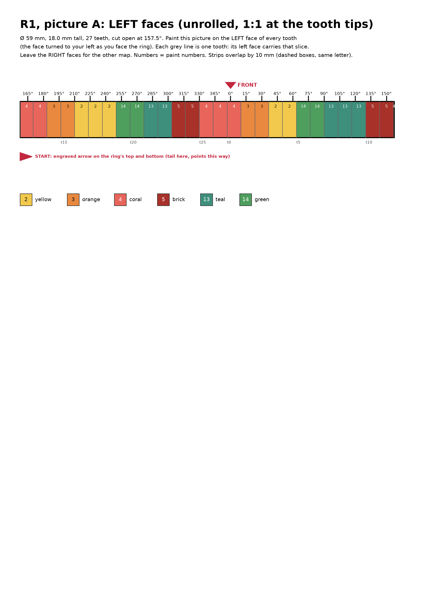
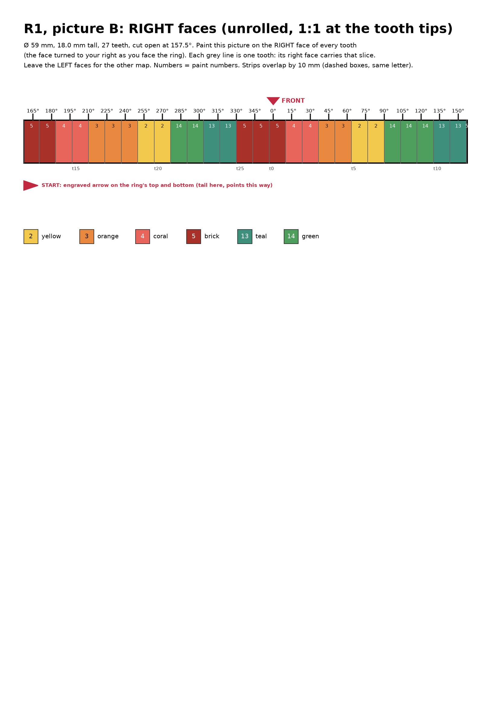
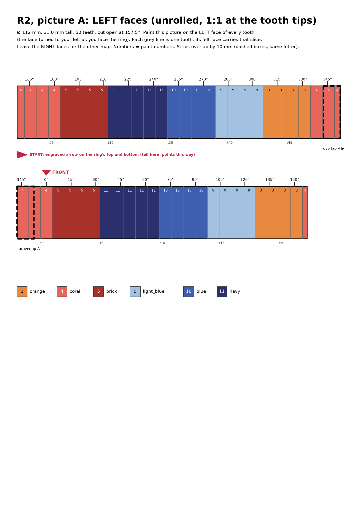
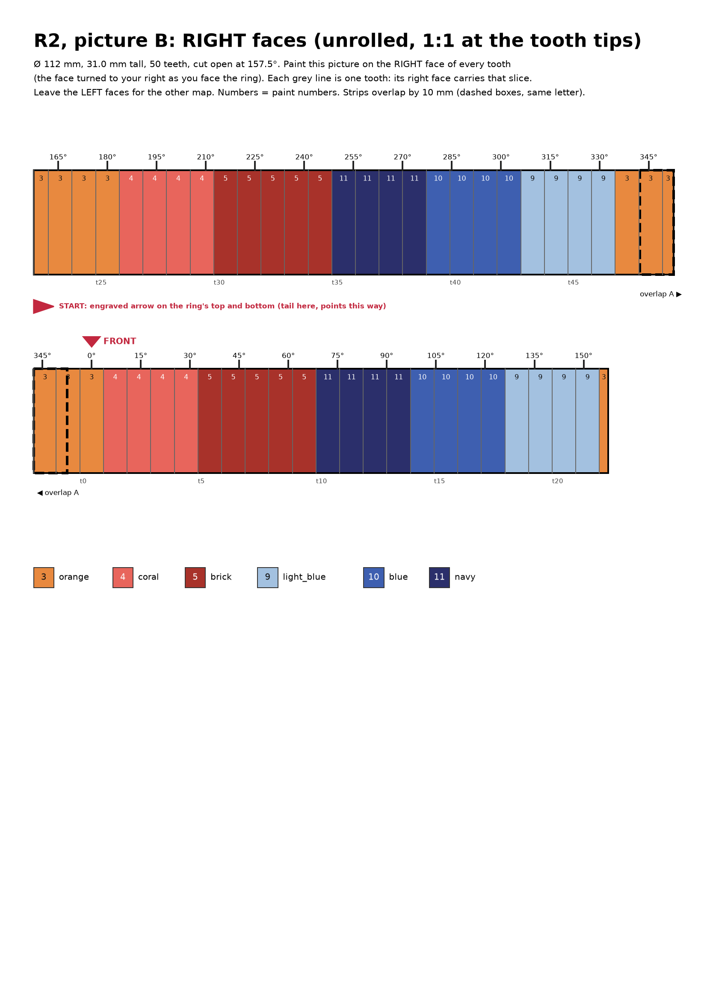
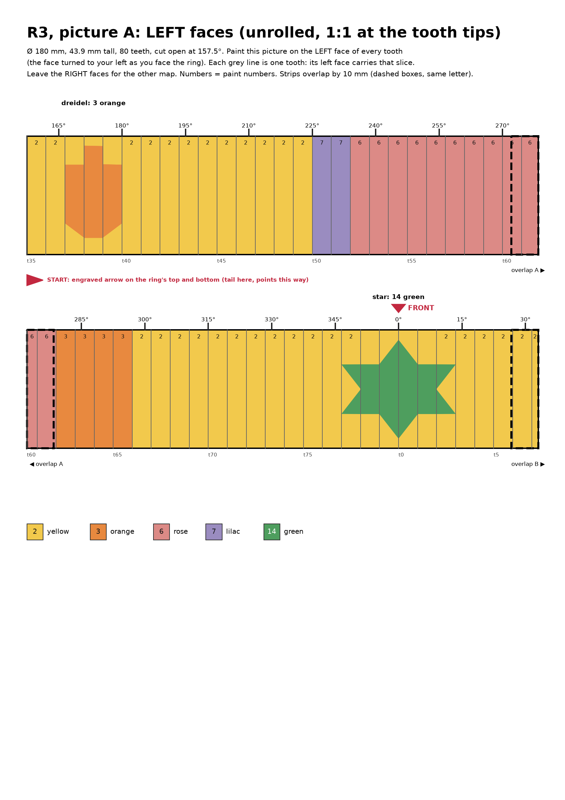
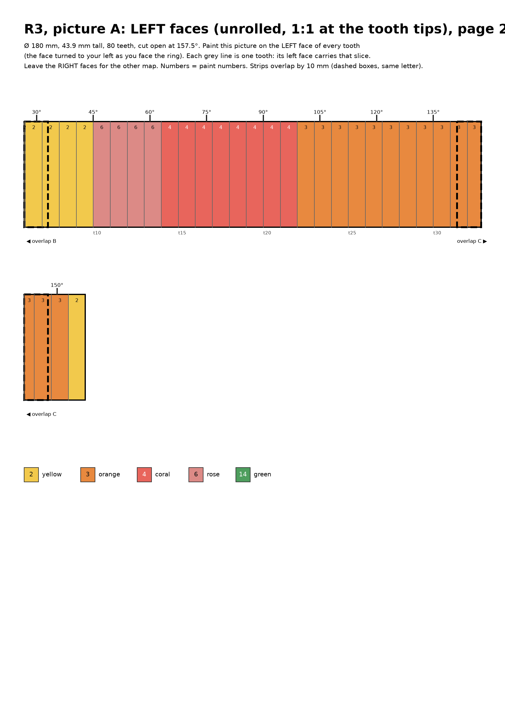
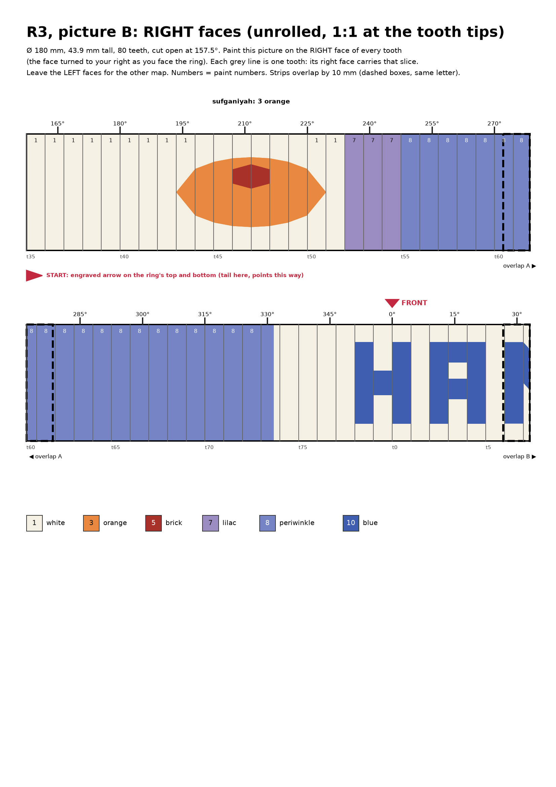
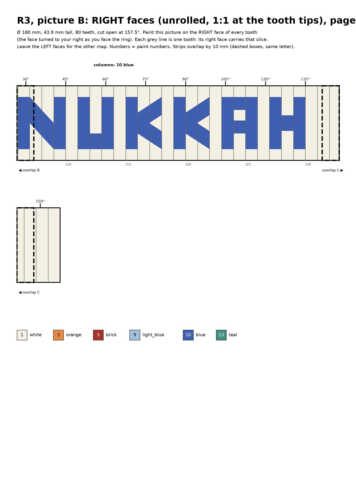
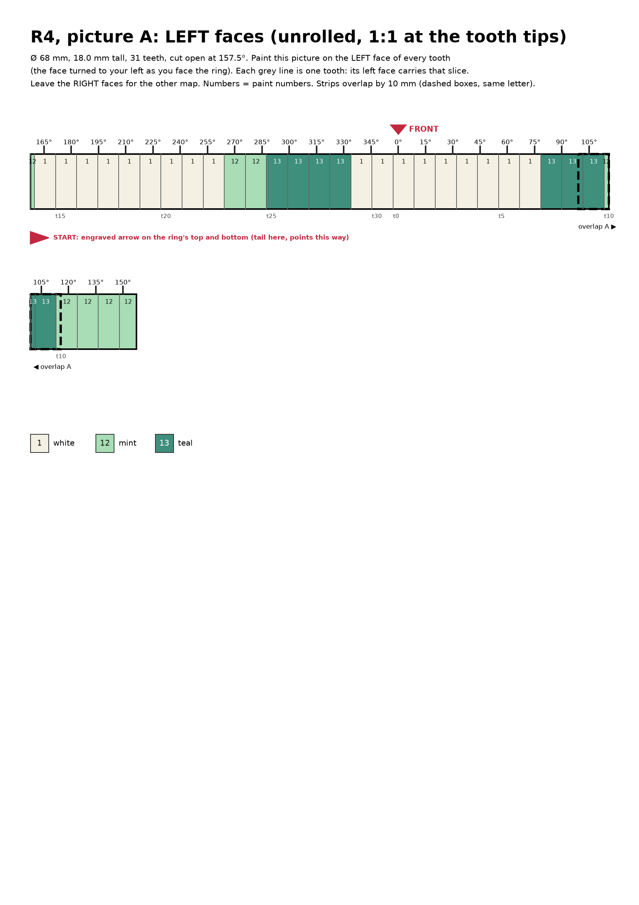
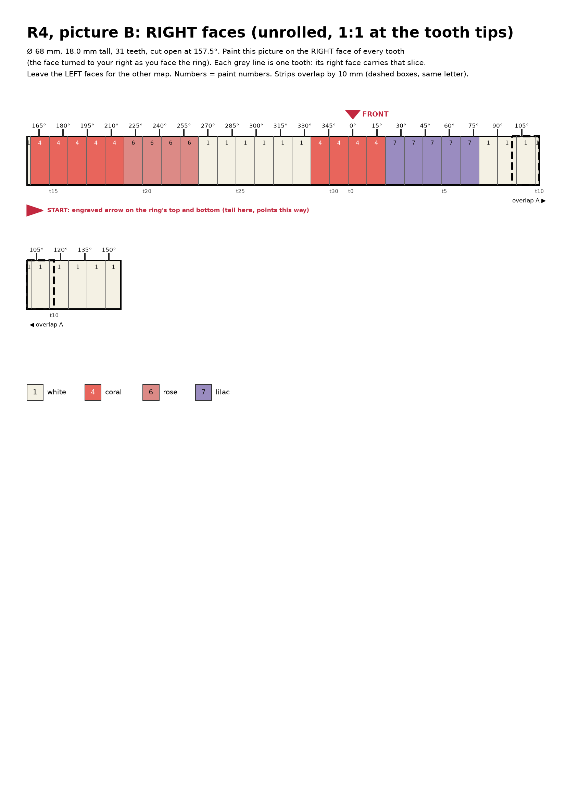
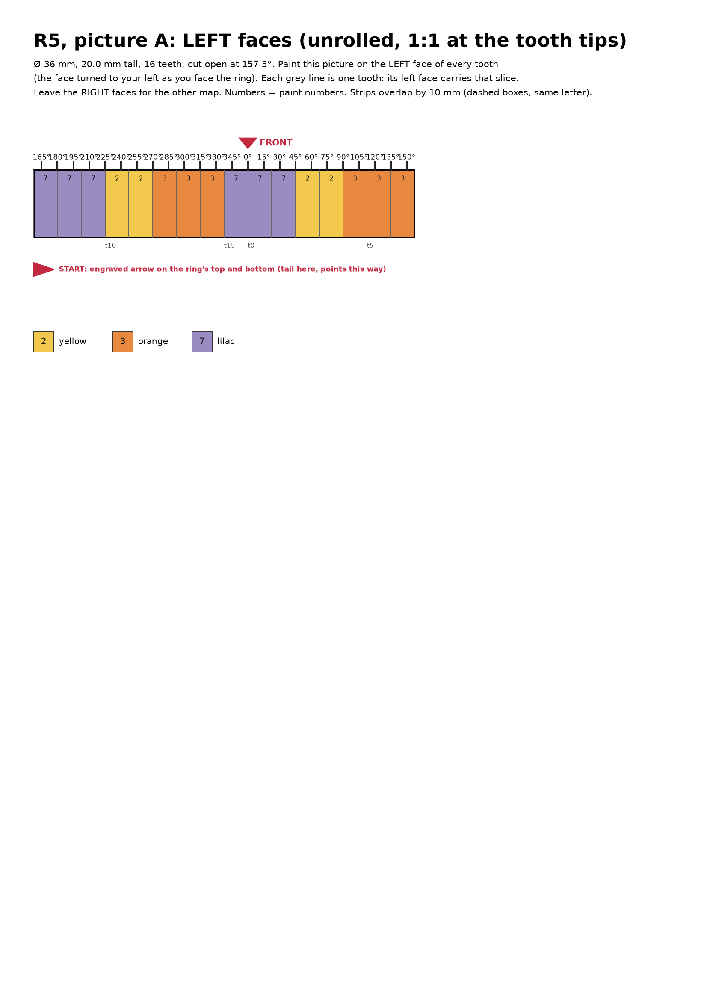
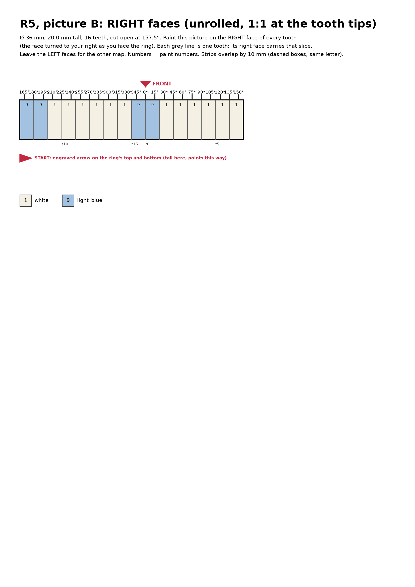
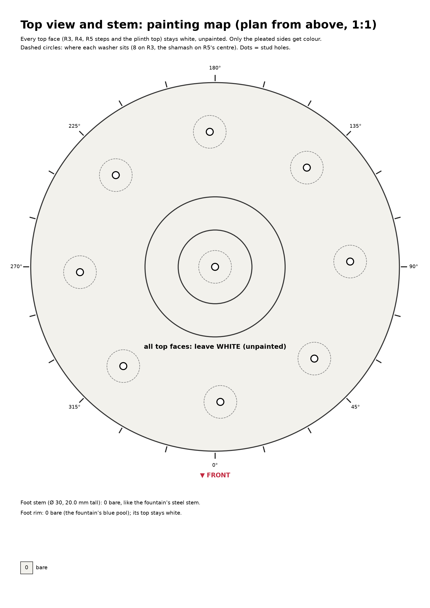

**איך קוראים מפה של טבעת:**
- כל **מלבן בין שני קווים אפורים** הוא **שן אחת**, וכל המלבן הוא **הפאה של הצד הזה** בשן הזאת (במפה A הפאה השמאלית, ב־B הימנית). **המספר** למעלה הוא מספר הצבע (הטבלה בסעיף 3.3, והמקרא בתחתית הדף). מלבן בלי מספר = לבן (1), נשאר מהפריימר.
- מתחת לפס: מספר השן (t0, t5, t10...). מעליו: **קנה מידה במעלות**.
- **▼ FRONT** (משולש אדום) = החזית, 0°.
- הטבעת "נחתכה" מאחור, ב־157.5°, ונפרשה משמאל לימין. **הקצה השמאלי של המפה הוא נקודת ההתחלה**, ועל הטבעת היא מסומנת ב**חץ שקוע** (סעיף 5.2). כשהיא ארוכה מדי לשורה אחת, היא ממשיכה בשורה הבאה. **המלבנים המקווקווים עם אות** (overlap A, B...) בסוף שורה ובתחילת הבאה הם אותן פאות בדיוק: חפיפה של 10 מ"מ.
- **בסמלים** (רק ב־R3): הצורה מצוירת בצבע שלה מעל הרקע, ומעל השורה כתוב השם והצבע (למשל "star: 14 green"). איפה שהסמל חוצה שן, רואים בדיוק איזה חלק מהפאה הוא סמל ואיזה רקע, וזה **בדיוק איפה שעובר הקו הבולט הדק על הפלסטיק**.

### 5.2 איך משתמשים בהן (👧 עם ליווי)
1. 🧑 **מדפיסים בגודל אמיתי:** בהגדרות ההדפסה בוחרים **"גודל ממשי" / "100%"**, **לא** "התאם לדף". המפה בקנה מידה 1:1 בקודקודי השיניים. **בדיקה:** 10 שיניים במפה (למשל מ־t10 ל־t20) = **70 מ"מ** בסרגל. אם לא, ההדפסה הוקטנה.
2. **מוצאים את חץ ההתחלה.** על כל טבעת יש **חץ קטן שקוע** (5 מ"מ, לא בולט) **גם במשטח העליון וגם במשטח התחתון**, ממש בפנים מהשיניים. **הזנב של החץ** נמצא בדיוק בנקודה שבה מתחילה המפה (157.5°, מאחור, בין שני נרות), **והחץ מצביע לכיוון שבו המפה ממשיכה**: משמאל לימין כשמסתכלים על הטבעת מהצד. החץ התחתון שימושי כשהטבעת עומדת הפוכה על כוס; העליון כשהיא עומדת ישר. בצביעה הם לא נצבעים, ואחרי ההרכבה רואים רק את העליון, וכמעט שלא.
3. **גוזרים את הפסים** של המפה (מחברים שורה לשורה לפי אותיות החפיפה), ו**מצמידים את הפס לטבעת**: מעמידים את הטבעת על השולחן ושמים את הפס ממש מתחת לשיניים (או עוטפים את הטבעת בגליל נייר ומדביקים עליו). **מיישרים את הקצה השמאלי של הפס מול הזנב של החץ**, והפס רץ בכיוון החץ. עכשיו כל מלבן עומד מול השן שלו. ▼ FRONT במפה צריך ליפול על החזית (נר 1 ב־R3, אמצע מגן הדוד): בדיקה נוספת.
4. **רק מפה אחת פתוחה בכל פעם:** כשצובעים פאות שמאליות, על השולחן רק מפה A. כשמסיימים צד, מחליפים מפה.
5. **צבע אחד בכל פעם:** מוצאים במפה את כל המלבנים במספר הזה, וצובעים את הפאות האלה מסביב לטבעת. ברוב הטבעות אלה רצפים של כמה שיניים צמודות.
6. **מסמנים ✓** בעיפרון על המלבן **כל פאה שגמרו**. כך יודעים בדיוק איפה עצרו, גם אם מפסיקים באמצע.
7. **בתחילת וסוף כל רצף, בודקים** את מספר השן (t20, t25...) מול הטבעת. טעות של שן אחת מזיזה רצף שלם.

**טיפ:** מדפיסים **שני עותקים** של כל מפה: אחד לסימון ✓ של השכבה הראשונה ואחד של השנייה. ואם שתי בנות עובדות על אותה טבעת, אחת עם A ואחת עם B, ולא באותו זמן.

---

## 6. טכניקה (👧 עם ליווי)

### 6.1 סידור שולחן
מפה, נייר מגבת, שתי כוסות מים, צלחת חד־פעמית כפלטה, מקלות אוזניים, **המפות המודפסות**, **טבעת הניסיון הצבועה** ועיפרון. אור טוב.

### 6.2 צובעים חלקים בנפרד, לפני הרכבה
- כל טבעת נצבעת לבד, על "ידית": גליל נייר טואלט או כוס הפוכה בחור המרכזי.
- R3 גדולה (18 ס"מ) ונוח לצבוע אותה כשהיא עומדת על כוס הפוכה, ומסובבים אותה ולא את היד.
- **לא נוגעים במשטחים העליונים** עם צבע. אם נשענים עליהם, רק עם כפפה נקייה.

### 6.3 צד אחד בכל פעם
זה הכלל הכי חשוב: **אף פעם לא צובעים את שני הצדדים באותו מפגש.** קודם תמונה A של טבעת (כל הפאות השמאליות), ייבוש, ורק אחר כך תמונה B.

1. **רואים רק צד אחד.** כדי לצבוע **פאות שמאליות**, מסובבים ומטים את הטבעת כך שאת מסתכלת עליה **משמאל**: הפאות השמאליות פונות אלייך כמעט שטוחות, והימניות מתחבאות. לפאות הימניות, להפך. השיניים חדות (70°), אז מספיקה הטיה קטנה כדי שהצד השני ייעלם. היד מגיעה רק לצד הנכון.
2. **הטוש לאורך הפאה, מלמטה למעלה.** מניחים את קצה ה־Posca **בעמק** שבין שתי שיניים, ומושכים לאורך הפאה עד הקודקוד. **הקודקוד הוא קו העצירה**: לא עוברים אותו.
3. **רצף אחרי רצף.** לוקחים טוש אחד וצובעים את כל הרצף שלו בצד הזה (למשל 10 פאות צהובות צמודות), ואז את הרצף הבא באותו צבע מסביב לטבעת. ✓ במפה, ואז הצבע הבא.
4. **פאות לבנות:** לא צובעים. אם בטעות נגעו, מתקנים בלבן.
5. **בודקים מהצד השני.** אחרי כל צד, הילדה מסתכלת על הטבעת מהצד ההפוך. אם צבע עבר את הקודקוד לצד הלא נכון, מסמנים ומתקנים אחרי ייבוש.

### 6.4 בהיר לפני כהה
- בכל צד: **הבהירים קודם**: צהוב, מנטה, תכלת, ורוד־סלמון, כתום, אלמוג, לילך. **אחריהם** הבינוניים: ירוק, פריווינקל, טורקיז. **אחרונים** הכהים: כחול, לבנה, נייבי.
- כך צבע כהה שגולש נוחת על פאה שכבר צבועה, ורואים מיד מה לתקן. בהיר מעל כהה לא מכסה.
- **בסמלים** אותו עיקרון: הרקע הבהיר (צהוב) קודם, הסמל אחריו (סעיף 7).

### 6.5 שכבות דקות
- שתי שכבות דקות תמיד ייראו טוב יותר משכבה אחת עבה.
- **Posca:** מנערים עד שהכדור מקשקש, לוחצים על דף פסולת עד שהצבע זורם, וצובעים בתנועות בכיוון אחד, **מלמטה למעלה לאורך הפאה**. לא חוזרים על אזור רטוב, כי זה מרים את השכבה. 10 עד 15 דקות בין שכבות. בזמן שצד אחד מתייבש, עובדים על טבעת אחרת.
- **אקריליק (לבנה, פריווינקל):** מעט צבע על מכחול עגול 2, ומורחים כמו חמאה דקה, לאורך הפאה. 20 עד 30 דקות בין שכבות.

### 6.6 הרגל
- **הרגל כולה לבנה:** מקבלת פריימר ולכה, בלי צבע. אם נגע בה צבע, לבן Posca, שתי שכבות.
- **מתחת לרגל:** בלי פריימר ובלי לכה בכיסים של המשקולות (ממוסכים).

### 6.7 תיקון טעויות
- **רטוב:** מקל אוזניים לח מוריד מיד. לא לשפשף בכוח.
- **צבע שעבר את הקודקוד לצד השני:** אחרי ייבוש, צובעים מעליו בצבע של הפאה ההיא (מהמפה של הצד ההוא). אם הפאה לבנה, לבן, שתי שכבות.
- **פאה בצבע לא נכון:** בהיר מעל כהה לא יכסה. קודם לבן, ייבוש, ואז הצבע הנכון.
- **"הרצף זז בשן אחת":** מתקנים את הפאה הראשונה או האחרונה בלבד ומיישרים שוב מול המפה. ממרחק של צעד אף אחד לא יראה שן אחת.
- **צבע על משטח עליון:** אחרי ייבוש, לבן Posca PC-3M, שתי שכבות.
- **טיפה או בועה:** מחכים שיתייבש, משייפים בעדינות בנייר 400, וצובעים מעל.
- אומרים לבנות מראש: "כל טעות אפשר לתקן", כדי שלא ילחצו.

### 6.8 חלוקת עבודה בין שתי בנות
- **לפי צדדים (מומלץ):** אחת לוקחת את **תמונה A** של כל הטבעות (ב־R3: הצבעים החמים, מגן הדוד והסביבון); השנייה את **תמונה B** (ב־R3: הכחולים ו־HANUKKAH). אף אחת לא נוגעת בצד של השנייה. ב־R1 וב־R2 שני הצדדים באותם צבעים (מעבר צבעים, צעד אחד זה מזה), אז שם עובדות בתורות עם אותם טושים, או טבעת לכל אחת.
- **לפי טבעות:** אחת R1, R2, R4 ו־R5, השנייה R3 (לבד היא כמעט חצי מהעבודה, ובה שלושת הסמלים).
- **הקטנה:** R5, R4, והרצפים הארוכים הצהובים של R3. **הגדולה:** הסמלים.
- **העדינים ביותר** (הפסים הקצרים באותיות) אפשר לשמור להורה.
- מפגש של 30 עד 45 דקות לכל היותר; עדיף שלושה קצרים מאחד ארוך.

---

## 7. הסמלים על R3

**כל סמל צבוע על צד אחד בלבד**, ולכן רואים אותו רק מצד אחד. **אין קו מתאר ואין רכס צביעה**: הקצה של הסמל הוא פשוט המקום שבו צבע אחד נגמר ואחר מתחיל. על הפלסטיק יש **קו בולט עדין מאוד לאורך הקצה**, רק על הפאות של הסמל. מתחת לצבע הוא כמעט נעלם; הוא שם כדי לעצור טוש ולהשעין עליו נייר מיסוך.

### 7.1 איפה כל סמל ובאיזה צבע (0° = חזית)

| סמל | צד (רואים מ...) | איפה | צבע | על רקע |
|---|---|---|---|---|
| **HANUKKAH**, שורה אחת, **אותיות של פאות שלמות** גבוהות 31 מ"מ, 32 פאות = 144° רוחב | **B, פאות ימניות** (מימין) | **מתחילה 9° משמאל לחזית** ונמשכת ימינה עד 135° (באמצע: 63°) | **10 כחול** | **1 לבן** (רצועה רחבה מהמילה ב־5° מכל צד, מהפריימר) |
| **מגן דוד**, מלא, 37 מ"מ | **A, פאות שמאליות** (משמאל) | **חזית, 0°** | **14 ירוק** | **2 צהוב** |
| **סביבון**, צללית בלי אות | **A, פאות שמאליות** (משמאל) | **אחור, 173°** | **3 כתום** | **2 צהוב** |
| **סופגנייה**: אליפסה 57×26 מ"מ ונקודת ריבה למעלה | **B, פאות ימניות** (מימין) | **אחור, 212°** (194° עד 230°) | **3 כתום**, ריבה **5 לבנה** | **1 לבן** |

**איך זה נקרא:** עומדים 40° ימינה מהחזית: "HANU" נקראת, וכשהולכים ימינה סביב החנוכייה, המילה כולה. עומדים 40° שמאלה מהחזית: רק מגן הדוד על צהוב, בלי זכר למילה (בגלל זה היא מתחילה רק ב־8°−). מלפנים, שני הסמלים מתערבבים לפסים. כל אות "חתוכה" לפרוסות צרות, פרוסה על כל פאה: מקרוב זה נראה כמו פסים מוזרים, וזה בסדר גמור. **כדאי להראות לבנות את טבעת הניסיון מהצד אחרי שהיא צבועה**: זה הרגע הכי מרגש.

### 7.2 הסדר
**בתמונה A של R3 (משמאל):**
1. **הרקע הצהוב** על כל הפאות הצהובות, **כולל השטח של מגן הדוד והסביבון** (ירוק וכתום מכסים צהוב יפה).
2. שאר הרצפים של A (ורוד, אלמוג, כתום, לילך), כרגיל.
3. ייבוש חצי שעה.
4. **מגן הדוד בירוק**, פרוסה אחרי פרוסה, עד הקו הדק (7.3). 2 שכבות.
5. **הסביבון בכתום**, כולו, עד הקווים הדקים. 2 עד 3 שכבות.

**בתמונה B של R3 (מימין):**
1. כל רצפי הצבע של B (טורקיז, כחול, לילך, פריווינקל). **הרצועה הלבנה של 183°** סביב החזית נשארת לבנה: לפי המפה, שם יש רק אותיות.
2. ייבוש.
3. **האותיות בכחול**, פרוסה אחרי פרוסה, **משמאל לימין** (H, A, N, U, K, K, A, H), כך שיד ימין לא נשענת על צבע רטוב. שמאליות: מימין לשמאל. 2 שכבות.
4. **כל אות בנויה מפאות שלמות:** פאה אחת = עמודה אחת במפה. כל פאה של אות כחולה **לכל הגובה**, או שיש בה **פס אופקי אחד או שניים** (מדביקים מסקינג טייפ אופקי מעל ומתחת לפס וצובעים). **כל קו הוא קו ישר אחד מצד לצד של הפאה**, אף פעם לא נשבר באמצע פאה. יש אלכסונים רק ב־N וב־K: כל אחד עובר על שתי פאות, ובכל פאה מדביקים טייפ באלכסון ישר מקצה לקצה שלה, בהמשך לקו שבפאה הקודמת. ב־K, בפאה שליד הקו העומד יש חלק אחד שמתרחב, ובפאה הבאה שתי הזרועות נפרדות בדיוק על הרכס שבין הפאות. אין חריצים או עיגולים. בין אות לאות פאה לבנה אחת.
5. **הסופגנייה בכתום** (3), על הרקע הלבן מאחור, עד הקו הדק, ומשאירים לבן את נקודת הריבה. אחרי ייבוש: **הריבה בלבנה** (5), שתי פאות. 2 שכבות לכל אחד.

### 7.3 צבע עד הקו הדק, פרוסה אחרי פרוסה
- כל סמל "חתוך" על ידי השיניים ל**פרוסות** אנכיות, ו**כל פרוסה עוברת על כל רוחב הפאה**, מרכס לרכס: אין פאה שהצורה נגמרת באמצעה. הקצה העליון והתחתון של כל פרוסה הם קו ישר אחד מרכס לרכס (הסופגנייה, למשל, בנויה מפרוסות כאלה, כמו מצולע). חוד (פינת כוכב, תחתית הסביבון) נגמר בנקודה על רכס. **המפה מראה בדיוק כל פרוסה**, והקו הדק על הפלסטיק עובר באותו מקום.
- **שיטה 1, "עד הקו" (מומלצת אם עבדה על טבעת הניסיון):** צובעים את הפרוסה מבפנים החוצה עם **PC-3M**, ומתקרבים לקו בסוף. הקו הבולט עוצר את קצה הטוש. בפרוסות הכי צרות (פינות של כוכב, קצוות של אות): **PC-1MR**.
- **שיטה 2, מיסוך (אם "עד הקו" לא עבד על טבעת הניסיון):** 🧑 מדביקים **Tamiya גמיש 2 עד 3 מ"מ** כך שהקצה שלו **נשען על הקו הדק מבחוץ** לסמל, ולוחצים בציפורן. אין קימורים: כל הקווים ישרים, מרכס לרכס. צובעים, ומסירים את הנייר כשהצבע כמעט יבש, בזווית נמוכה. זה לוקח זמן: עדיף שההורה ידביק בערב, והבנות יצבעו למחרת.
- **רק הצד של הסמל:** כל הסמלים הם על צד אחד. **לא צובעים את הפאות של הצד השני** בתוך השטח של הסמל, הן שייכות לתמונה האחרת (לפי המפה שלה).
- **מטים את הטבעת** כמו בסעיף 6.3: לסמלים של A מסתכלים משמאל, ל־HANUKKAH מימין.

### 7.4 תיקונים בסמלים
- צבע של סמל שעבר את הקו החוצה: אחרי ייבוש, מחזירים את צבע הרקע (צהוב צריך 2 שכבות מעל ירוק או כתום, אז עדיף קודם לבן).
- כחול שעבר לרצועה הלבנה: לבן, 2 שכבות.
- קצה לא ישר: מרחק של צעד לא רואים את זה, כי הפרוסות ממילא חותכות את הקצה.

---

## 8. לכה וחום

### 8.1 לכה (🧑 הורה)
**למה כן לכה על PETG:** גם עם הכנה טובה, השכבה של Posca ואקריליק על PETG רכה יותר משכבה על PLA, ונשרטת בקודקודי השיניים כשמרכיבים ומפרקים כל שנה. לכה שקופה מגינה עליה, ועל המדרגה הלבנה של R3 היא גם עוזרת לשעווה לרדת.

- **מה:** **מה שעבד על טבעת הניסיון** (סעיף 4.2, שורה 6). לכה **על בסיס מים**: אקרילית, או **פוליאוריתן־אקרילי על בסיס מים** (למשל Polycrylic, או "לכה על בסיס מים" של טמבור/נירלט). **לא** לכה סינתטית/על בסיס טרפנטין (מצהיבה, מריחה בחום, ונסדקת על פלסטיק גמיש).
- **ברק:** מבריקה (Gloss) קרובה למראה של המתכת הצבועה במזרקה; מט (Matte) מסתירה טביעות אצבעות וקווי הדפסה. סאטן היא פשרה טובה.
- **מתי:** **24 עד 48 שעות** אחרי הצביעה האחרונה. Posca על PETG מתקשה לאט; לכה מוקדמת מדי מרככת אותו.
- **איך, על Posca:** לכה במכחול עלולה למרוח את הצבע. עדיף **ספריי לכה אקרילית שקופה** (Talens, Motip Clear או Rust-Oleum Clear), בחוץ: **שכבה ראשונה דקיקה כמו אבק**, 10 דקות, ואז עוד 2 שכבות דקות.
- **בלי לכה** על מושבי הדסקיות, בחיבורים ובכיסים מתחת לרגל. המיסוך מהפריימר נשאר עד אחרי הלכה.
- ייבוש 24 שעות לפני שנוגעים, 48 שעות לפני הדלקה.

### 8.2 חום
- כל החלקים מודפסים ב־PETG, שמתרכך בסביבות 70 עד 80°C. כל נר עומד **בגביע מתכת על דסקית נירוסטה**, והם מגינים על הפלסטיק. **לא מדליקים בלי הגביעים והדסקיות.**
- **ליד הגביעים אין צבע:** המדרגה של R3 לבנה (פריימר ולכה בלבד), וטבעת המיקום מחזיקה כל דסקית במקום. הצבע הקרוב ביותר הוא על השיניים של R3, מתחת לפי הגביעים ובמרחק של כ־2 ס"מ, ועל השיניים של R4, 32 מ"מ מכל להבה.
- **שעווה על המדרגה:** נותנים לה להתקרר ולהתקשות (אפשר 10 דקות במקפיא, לחלק בלבד), ומורידים בכרטיס פלסטיק או בציפורן. **לא** בסכין, ולא במייבש שיער או במים חמים.
- **בדיקת שריפה מלאה** (`concept.md` §3): אחרי הניסיון, על החנוכייה המורכבת, 8 נרות ושמש עד הסוף. בודקים שהשיניים של R4 והמדרגה של R3 ליד הגביעים לא התרככו, לא הבריקו ולא הריחו.
- **בטיחות:** נרות חנוכה דקים רגילים בלבד, בלי נרות טי־לייט ובלי כוסות שמן. מגש מתכת או אריח בקוטר 20 ס"מ לפחות, רחוק מווילונות, שיער ושרוולים. מבוגר מדליק **ונשאר בחדר** עד שכל הנרות כבים. מחכים 10 דקות לפני שמזיזים.

---

## 9. לוח זמנים

טבעת הניסיון מוסיפה כמה ימים בהתחלה, אבל היא חוסכת הדפסה מחדש של R3. את שאר החלקים מדפיסים **בזמן** שהיא עוברת את הבדיקות, ואת R3 רק אחרי שהקווים הדקים שלה התאימו למפה.

| מתי | מי | מה | זמן |
|---|---|---|---|
| **יום 1** | 🧑 | הדפסת טבעת הניסיון 60% (כ־4.5 שעות; ואם רוצים, גם הקופון). השוואת הקווים הדקים למפה. שיוף, IPA, מקדם הדבקה ופריימר לבן, ייבוש לילה. **מתחילים להדפיס את שאר החלקים** | שעה + הדפסה |
| **יום 2** | 🧑👧 | **טבעת הניסיון:** סלוטייפ (שורה 1), מיסוך מול "עד הקו" (2, 3), תמונה A ואז B (4), כיסוי וגוונים (5). 🧑 ערבוב לבנה ופריווינקל | 45 דק' |
| **יום 3 עד 4** | 🧑 | לכה על טבעת הניסיון (6). ממשיכים להדפיס | 20 דק' |
| **יום 5** | 🧑 | **שעווה** (8), ו**חום** על הקופון אם הודפס (7). מחליטים: מיסוך או "עד הקו", איזו לכה, כמה שכבות | שעה |
| **יום 5, ערב** | 🧑 | החלקים האמיתיים: ניקוי, שיוף, IPA, מיסוך המושבים, החיבורים והכיסים. מקדם הדבקה + פריימר, ייבוש לילה | שעתיים |
| **יום 6, בוקר** | 🧑 | בדיקת סלוטייפ. הדפסת 14 המפות ב־100% ובדיקת 70 מ"מ. הרכבה יבשה וסימון "חזית" | 30 דק' |
| **יום 6, מפגש א'** | 👧👧 | **תמונה A** של R1, R2, R4, R5 (אחת), **תמונה B** של אותן טבעות (השנייה, טבעות אחרות באותו זמן). שכבה 1 | 45 דק' |
| **יום 6, מפגש ב'** | 👧👧 | שכבה 2 | 45 דק' |
| **יום 7, מפגש ג'** | 👧👧 | **R3 תמונה A:** כל הרצפים, כולל הרקע הצהוב. שכבה 1 ו־2 | 45 דק' |
| **יום 7, מפגש ד'** | 👧👧 | **R3 תמונה B:** כל הרצפים, הרצועה הלבנה נשארת. שכבה 1 ו־2 | 45 דק' |
| **יום 8, מפגש ה'** | 👧👧 | **הסמלים:** מגן דוד, סביבון, HANUKKAH, שכבה 1 | 45 דק' |
| **יום 8, מפגש ו'** | 👧🧑 | סמלים שכבה 2 והסופגנייה, תיקונים בלבן. בדיקה מכל צד מול המפות, ✓ אחרון | 40 דק' |
| **יום 9, ערב** | 🧑 | לכה (2 עד 3 שכבות דקות, בחוץ) | 30 דק' |
| **יום 10** | 🧑👧 | הסרת המיסוך, הדבקת המשקולות, הרכבה על הציר, דסקיות וגביעים | 30 דק' |
| **יום 11** | כולם | 48 שעות אחרי הלכה: בדיקת שריפה מלאה, ואז הדלקה 🕎 | |

אם הזמן לוחץ: מקצרים את הניסיון לשורות 1 ו־4 (הדבקה, שתי התמונות), ועושים את בדיקת החום בבדיקת השריפה המלאה, ומוותרים על הלכה (Posca ואקריליק מעל פריימר מחזיקים לשימוש עדין).

---

## 10. רשימת קניות

כמויות לחנוכייה אחת (R3 בקוטר 18 ס"מ, 6 חלקים לצביעה, 408 פאות, מהן כ־320 בצבע), לשתי בנות. **הגביעים, הדסקיות, הברגים ו־32 דסקיות המשקולת M10** הם חלק מהבנייה; הרשימה שלהם ב־`model/README.md`.

**לבנות (צבע):**
- [ ] Posca PC-5M, **12 גוונים בודדים** (אין סט שמתאים לפלטה של המזרקה): Sunshine Yellow, Light Orange, Coral Pink, Salmon Pink, Lavender, Light Blue, Blue, Navy Blue, Mint, Emerald Green, Green, ו־**White** לתיקונים. בוחרים בחנות מול הדף המודפס. כ־17 עד 22 ₪ ליחידה, **כ־230 ₪**.
- [ ] **עותק שני** של: **צהוב** (53 פאות, רובן הגבוהות של R3, ורקע לשני סמלים; מכסה חלש), **כתום** (47 פאות, הסביבון והסופגנייה) ו**אלמוג** (42 פאות, רובן על R1 ו־R2). 3 טושים, כ־60 ₪.
- [ ] אקריליק 120 מ"ל: **Naphthol Red Deep** (לבנה), **Ultramarine**, **Permanent Blue Violet** (פריווינקל, עם לבן), **Titanium White**. 4 בקבוקים, 15 עד 20 ₪ ליחידה, **כ־70 ₪**. וצנצנת קטנה עם מכסה לכל ערבוב.
- [ ] Posca **PC-3M** (ראש דק) לסמלים: **ירוק, כתום, כחול, צהוב**. הם משמשים גם לטבעת הניסיון, שהפאות שלה צרות יותר. כ־17 עד 20 ₪ ליחידה.
- [ ] Posca **PC-1MR**: **לבן** (תיקונים עדינים) ו**כחול** (קצוות צרים של האותיות). כ־20 ₪ ליחידה.
- [ ] מכחולים סינתטיים רכים: עגול 0, עגול 2, שטוח 15 מ"מ. סט של כ־20 עד 35 ₪.

**להורה (הכנה וגימור):**
- [ ] **מקדם הדבקה / פריימר לפלסטיק** בספריי (Motip Plastic Primer או Rust-Oleum Plastic Primer), 400 מ"ל ×1, 40 עד 60 ₪.
- [ ] פריימר **לבן** בספריי, רצוי מאותו יצרן ("מילוי" או "לפלסטיק"), 400 מ"ל ×1, 35 עד 60 ₪.
- [ ] **כוהל איזופרופילי (IPA)** 70% עד 99%, חצי ליטר, ומטליות מיקרופייבר, כ־30 ₪.
- [ ] נייר שיוף 320 ו־400 (רטוב־יבש) ו**ספוג שיוף עדין** (fine/superfine, או Scotch-Brite אפור), כ־20 ₪.
- [ ] לכה שקופה: **ספריי אקרילי** או **פוליאוריתן־אקרילי על בסיס מים**, לפי טבעת הניסיון, Gloss או Satin, 30 עד 50 ₪.
- [ ] נייר מיסוך Tamiya 10 מ"מ (מושבים, כיסים, חיבורים), 15 עד 25 ₪, ו־**Tamiya גמיש 2 או 3 מ"מ** (לאורך הקווים הדקים של הסמלים, אם משתמשים במיסוך), 20 עד 30 ₪.
- [ ] מסכה FFP2 וכפפות ניטריל, כ־20 ₪.
- [ ] פלסטלינה, לאטום את 9 חורי הברגים.
- [ ] **הדפסה צבעונית** של 14 המפות, פעמיים (28 דפי A4), ועוד 2 דפים של טבעת הניסיון (והקופון, אם מדפיסים אותו).

**מהבית:** עיפרון, סרגל, מספריים, סלוטייפ (לחבר את פסי המפה ולבדיקת ההדבקה), מקלות אוזניים, מגבות נייר, צלחות חד־פעמיות, כוסות מים, מפה מניילון, חולצות ישנות, כוסות הפוכות וגלילי נייר טואלט כ"ידיות", מגש מתכת לבדיקת החום.

**סה"כ משוער:** כ־650 עד 800 ₪. רובו ה־Posca: 12 גוונים בודדים במקום סט, ועוד 6 טושים דקים. אפשר לחסוך כ־40 ₪ אם צובעים את המנטה (6 פאות קטנות של R4) באקריליק מעורבב במכחול במקום לקנות טוש.

---

## 11. קבצים נלווים
- **`../model/out/test_ring_R3_60.stl`** ו־**`../model/out/maps/map_test_ring_R3_60_A_left.png`** / **`_B_right.png`**: טבעת הניסיון ושתי המפות שלה (סעיף 4). **מתחילים כאן.** חלופות: `test_ring_R3_50` / `_70`, או הקופון `test_coupon_R3.stl` עם `map_test_coupon_R3.png`.
- **`../model/out/maps/`**: **שתי מפות צביעה לכל טבעת**, A ו־B (סעיף 5). מדפיסים ב־100%, מצמידים לטבעת לפי ▼ FRONT, ומסמנים ✓.
- **`colour-chart.html`**: 3 דפי A4 להדפסה, בעברית. דף 1: 15 הצבעים, מה בכל טבעת בכל צד, וכללי הזהב. דף 2: טבעת הניסיון ושלושת הסמלים. דף 3: המפות בקטן ואיך משתמשים בהן. מדפיסים עותק לכל ילדה, כותבים "מי" ומסמנים ✓.
- **`../model/previews/painted_*.png`**, **`test_two_pictures_R3_*.png`** ו־**`test_ring_R3_60_from_left/front/right.png`**: איך החנוכייה וטבעת הניסיון אמורות להיראות מכל צד. כדאי להראות לבנות לפני שמתחילים.
